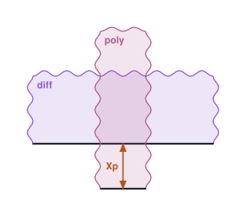
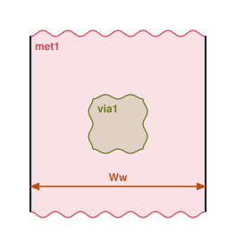
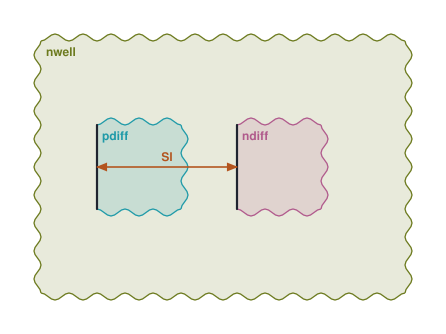
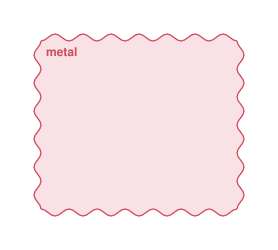
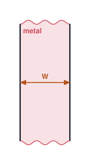
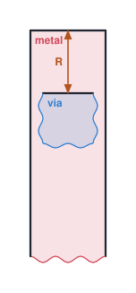
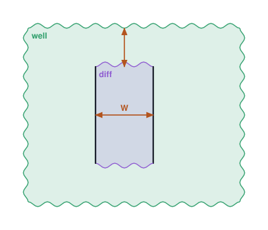

# FastDRC

**Design rules drawn, not programmed.** You describe a DRC rule the way a design manual
does — draw an example of the geometry, put an arrow where a distance matters, write
what must hold — and FastDRC compiles the rules into a working
[KLayout](https://www.klayout.de) DRC script, with the same rules written out as plain
sentences to read back. *Fast*: the script is fitted to the set of rules being run —
the whole deck, or part of it — so what several rules need is computed once.

    pip install fastdrc                # the tool; pure Python, no compiler needed
    pip install fastdrc-gf180mcu       # the GF180MCU deck (brings the tool with it)

> Status: pre-alpha. This is the **rule compiler** with its **KLayout backend**
> (compared rule by rule with the public decks of several open processes), the
> self-test and the editor. Backends are plugins. A C++ checking core is being
> developed separately, on the `cpp-core` branch, to become a second backend; it is
> not part of `main` and nothing here needs it.

## Where it comes from

FastDRC began as a DRC engine, and the name is from that. The idea: a deck is not a
list of separate checks but one graph of operations — Boolean operations on layers,
sizing, selections, and the checks at the ends. Over a whole deck most of that graph
is shared, so each operation can be computed once, kept while something still needs
it, and run in parallel with the others. That is what should make millions of checks
fast.

An engine needs the rules in a form it can reason about, so the work started there:
how can a design rule be stated formally and still look like the page of the manual
it comes from? That question grew into what is here now — rules drawn by example and
a compiler that reads the drawing.

A rule stated this way belongs to no tool. The drawing and its constraints say what
the rule *is*; each backend turns that into something of its own — a KLayout script,
the rule as a sentence, its figure, the test layouts that show whether a deck obeys
it. The same description is meant to carry over to other checking tools as backends
are written for them.

The graph is already at work: the compiler builds one for the set of rules being run
and writes the KLayout script from it, so what several rules need is computed once.
The C++ core that will execute the graph itself is still in progress, on the
`cpp-core` branch.

## Authoring rules by drawing

You describe a rule the way a design manual does: **draw the shapes** of the layers in
the situation the rule is about, put an **arrow** where a distance matters, and write
the one or two things the manual says about it (`W >= 0.8`, `A.net != B.net`,
`Count(V) >= 2`). You do *not* write `.and` / `.not` / `.inside`: the compiler reads
what lies inside, across or beside what off the drawing and derives the operations.

|  |  |  |
|---|---|---|
| `Xp >= 0.2` | `Ww >= 2` (which metal), `Count(VW) >= 2` | `Sl <= 20` |
| *poly must extend at least 0.2 µm beyond diff* | *every met1 at least 2 µm wide must hold at least 2 via1* | *every part of pdiff combined with nwell must be within 20 µm of ndiff combined with nwell — one in the same piece of nwell* |
| `poly.enclosing(diff, 0.2.um, euclidian)` | `met1.sized(-0.999.um).sized(0.999.um).not_interacting(via1, 2)` | `pdiff.and(nwell).not(ndiff.and(nwell).sized(20.um))` |

Three rules of the example deck: the drawing, what is written on it, the sentence read
back from it, and the KLayout statement it compiles to.

**Straight and wavy edges.** Every edge of a drawn shape is one or the other, and this
is what makes a picture a rule and not a fixed pattern. A **straight** edge is one the
rule uses — it is measured, or its length or corner matters. A **wavy** edge asks
nothing of that side: the shape goes on, or ends, as it likes. The same rectangle:

|  |  |  |  |
|---|---|---|---|
| no straight edge: **any shape** of the layer (a minimum area) | two straight sides: **a wire** of any length (a minimum width) | the cap straight too: **the wire's end** (an end-of-line enclosure) | an arrow that ends on a wavy edge is **a link**, not a distance: the diff *inside* the well |

```
fastdrc init mydeck             # a deck is a folder: process.json + rules/<section>/<rule>.json
fastdrc gui mydeck              # draw the rules: one rule, one file, one drawing
fastdrc build mydeck            # -> build/<name>.drc (KLayout script), build/<name>.md (the rules as sentences)
fastdrc selftest mydeck         # does every constraint of every rule behave as drawn?
                                # ... and is every layout in mydeck/layouts/ read as it says? (whole devices: every rule gets its say)
fastdrc check chip.gds mydeck   # run the deck on a layout, list the violations per rule
fastdrc check chip.gds mydeck --only "3-metal,NW.*"   # part of the deck: one script fitted to that set
fastdrc check chip.gds mydeck --deep   # on the layout's hierarchy: a cell placed many times is checked once
fastdrc check chip.gds mydeck --profile NAME    # a process with options (metal stack, ...): `fastdrc parameters mydeck`
fastdrc pack mydeck             # -> mydeck.zip: the same deck in one file; every command and the editor take it
fastdrc check chip.gds gf180mcu # a deck installed as a package (pip install fastdrc-gf180mcu) goes by its name: `fastdrc decks`
```

`build`, `rules` and the editor need nothing but Python; `selftest`, `check` and the editor's
**Test** button run [KLayout](https://www.klayout.de) (`klayout` on the PATH, or
`KLAYOUT_BIN`).

> **Start with [docs/from-a-manual.md](docs/from-a-manual.md)** — one invented process
> taken from the manual's page to a deck that has been run, with every kind of rule
> ([`examples/demo/`](examples/demo)): `fastdrc build examples/demo`.
>
> **A real process: [`fastdrc-gf180mcu/`](fastdrc-gf180mcu)** — the open GF180MCU
> design rules drawn from the public manual, 775 rule files from the front end to
> antenna, bond pad, seal ring, dummy fill and latch-up rules, with the metal stack, the
> top metal, the MIM option and the kind of bond pad as parameters; compared with the
> process's own KLayout deck where it has one. It is a package of its own
> (`pip install fastdrc-gf180mcu`, then `fastdrc check chip.gds gf180mcu`); its README
> says how it was checked.
>
> **[docs/commands.md](docs/commands.md)** — every command and option.
> **[docs/plugins.md](docs/plugins.md)** — writing a backend for another tool, and
> packaging a deck.
>
> **📐 [docs/drawing-model.md](docs/drawing-model.md)** is the reference: how each kind
> of rule is drawn and what the compiler derives from it — widths, spacings,
> enclosures and extensions; a value per table column; exact sizes, squares and bars;
> arrays and counts; "on one of two sides"; maximum distances; a pitch from centre to
> centre; a side added up over several shapes; density; nets and antenna ratios; rules
> for a family of layers; and the cross ("must not exist").

**The self-test.** For each constraint of each rule, `selftest` builds small layouts
from the rule's own picture — a `check` with its quantity just outside the value (must
be reported) and exactly at it (must not), a `match` with a violation just outside the
filter (must *not* be reported) — and runs the deck on them. What the rule must do is
computed from the constraints, not from the deck. Rules it cannot build a case for are
listed, never counted as passing.

**Backends are plugins.** `fastdrc backends` lists them (`klayout`, `docs`, `svg`,
`facts`, `cases`); another package adds one through the entry-point group `fastdrc.backends`
— a class with one method, see [docs/plugins.md](docs/plugins.md).
A backend may use another (`get("svg")` for a rule's figure, `get("docs")` for its
sentence). A backend may also *run* the deck it writes on a layout: `build`, `check` and
`selftest` take `--backend NAME` and go through that one for both. KLayout is the one
shipped here that does, and the default; the C++ core will be another, and
[`fastdrc-gdscheck/`](fastdrc-gdscheck) is one for [gdscheck](https://github.com/aesc-silicon/gdscheck),
a package of its own (`pip install fastdrc-gdscheck`, then `--backend gdscheck`). This is how
another checking tool is put under the same drawn rules, and `fastdrc selftest --backend
NAME` then shows, rule by rule, whether that tool reads them as drawn.

The pieces (Python):

```
python/fastdrc/topology.py        spatial relations off geometry (inside / overlap / ...)
python/fastdrc/constraint.py      the constraint language (a Python-expression subset, parsed with `ast`)
python/fastdrc/rule.py            the analyzed-rule API the backends work against
python/fastdrc/sheet.py           rule files: a value per table column, layer families (and older multi-rule sheets)
python/fastdrc/process.py         a deck (a folder, a zip, or an installed package): build, check, self-test
python/fastdrc/params.py          the parameters of a process (its options), profiles, and the switch that reads them
python/fastdrc/ir.py              the set of rules as one graph of operations: what several rules need is computed once
python/fastdrc/backend.py         the backend registry and plugin discovery
python/fastdrc/backend_klayout.py -> a KLayout DRC deck
python/fastdrc/backend_docs.py    -> the rules as plain sentences
python/fastdrc/backend_svg.py     -> each rule's drawing as a picture
python/fastdrc/backend_cases.py   -> test layouts made from the drawings, with what to expect
python/fastdrc/editor.py          the visual editor (Tkinter)
python/fastdrc/cli.py             the `fastdrc` command
tools/compare_reports.py          two DRC runs of one layout, compared rule by rule, by place
tools/cells_in_a_row.rb           a cell library laid out flat, to try a deck on
tools/perturb_layout.rb           random small errors put into a layout
tools/tidy_drawings.py            a deck's drawings redrawn neatly, their meaning unchanged
tools/doc_figures.py              the docs' figures, drawn from the rule files (--check: are they current?)
```

The other `tools/` scripts validate the compiler against a reference deck and a
drawn-rule corpus read from `docs/gf180mcu/`, which is not part of this repository.

## Layout

```
python/fastdrc/    the Python package: the rule compiler, its backends, the editor
examples/demo/     a complete deck for an invented process, with every kind of rule
fastdrc-gf180mcu/  the package fastdrc-gf180mcu: the design rules of the open GF180MCU process, drawn from its manual
fastdrc-gdscheck/  the package fastdrc-gdscheck: a backend plugin that writes the rules for gdscheck and runs it
docs/              the tutorial (from-a-manual.md), the reference (drawing-model.md), the commands (commands.md),
                   plugins (plugins.md), what is new (own-and-known.md)
docs/img/          the docs' figures, drawn from rule files by tools/doc_figures.py
tools/             validation of the compiler against a reference deck
tests/             pytest
```

Three packages are built from this repository: `fastdrc` (the tool),
`fastdrc-gf180mcu` (the deck, which needs the tool) and `fastdrc-gdscheck` (a backend
plugin, which needs the tool). A deck package holds the deck
folder and names it in the entry-point group `fastdrc.decks`;
[docs/from-a-manual.md](docs/from-a-manual.md) shows the two lines it takes.

## Compiling a drawn rule

```python
from fastdrc.backend import get                # backends load on first use
from fastdrc.rule import Rule

# a drawn rule = shapes (edges) + measures + constraints; see docs/drawing-model.md
deck = get("klayout", layermap={"metal1": (34, 0)}).compile(Rule(my_drawn_rule))
text = get("docs").compile(Rule(my_drawn_rule))     # the same rule as a sentence

from fastdrc import process                    # a whole process folder
deck_path, text_path, n_rules, warnings = process.build("examples/demo")

folder, out = process.find("gf180mcu")         # a deck installed as a package, by its name
deck_path, *_ = process.build(folder, out)
```

## Install for development

Requires Python 3.11+; pure Python, no compiler.

```bash
pip install -e . -e ./fastdrc-gf180mcu -e ./fastdrc-gdscheck pytest     # the tool, the GF180MCU deck, the gdscheck backend
pytest
```

With [uv](https://docs.astral.sh/uv/): `uv sync` then `uv run pytest`. Tests that run a
deck need [KLayout](https://www.klayout.de) and are skipped without it.

## What is new here

Which part of FastDRC is its own, and which was already known from design manuals
and earlier publications: [docs/own-and-known.md](docs/own-and-known.md).

## Licence

FastDRC is released under the [Apache License 2.0](LICENSE); copyright 2026 Serge
Rabyking. The licence covers the tool. A deck you compile from your own drawings is
yours: the generated KLayout script, text and pictures carry no licence of FastDRC's.
