# Drawing DRC Rules — the geometry-by-example model

How a DRC rule is **drawn** so the compiler can turn it into a real check
(KLayout `.drc`, and eventually the FastDRC engine). This is the reference for the
rule editor and for `tools/validate_klayout.py` (`as_drawn`), which builds these
shapes for every deck rule it validates.

> New here? [from-a-manual.md](from-a-manual.md) walks one complete example from a
> manual's page to a deck that has been run; this file is the reference behind it.

## The core idea

A rule is **`shapes` + `measures` + `constraints`**.

- The **drawing carries the topology** — how shapes relate (inside / overlapping /
  abutting / disjoint). The compiler reads relations off the geometry, it does not
  take them from text.
- **Constraints carry only the non-visual facts** — which layer a shape is, a net,
  a numeric threshold. Anything you *can* see, you draw; anything you can't, you
  write as a constraint.

So you draw an **example** of the situation the rule is about, and annotate it.

> **You draw real shapes of real layers — never layer algebra.** You never draw or
> write `.and`, `.not`, `.inside`, `.outside`, `.not_interacting`, a "derived
> layer", a selection, or a scope. You draw `comp` and `mos_cap_mk` as two real
> shapes that overlap; the **compiler** looks at how they relate and *heuristically
> derives* that it must build `comp.and(mos_cap_mk)` to implement the rule. Every
> "**→ compiles to**" line below is the **compiler's output** — what it produces to
> run the check — not something you draw or type. The whole point is that you think
> in geometry and the compiler thinks in operations.

---

## Edges: wavy vs straight

Every shape is a closed loop of edges. Each edge is one of:

- **straight** (`edge: true`) — a **real, oriented** edge that the rule actually
  uses (it is measured, or its orientation/corner matters). It has a direction, so
  two straight edges can be "the same orientation".
- **wavy** (`edge: false`) — a **don't-care boundary**: the rule places no
  constraint on it. It is *arbitrary*. For a wire's open ends that reads as "any
  length" (the shape continues); for a closed shape whose outline is irrelevant it
  reads as "any polygon". A wavy edge does **not** mean the shape is unbounded — it
  means *this edge's geometry is unspecified*.

The same rectangle, four meanings — only the kind of its edges differs:

| 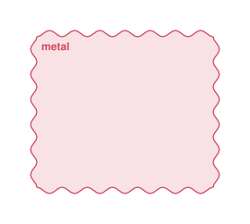 | 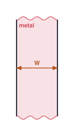 | 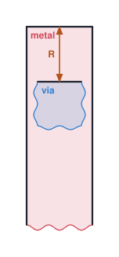 | 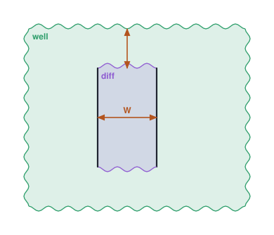 |
|---|---|---|---|
| **No straight edge**: any shape of the layer. `A.area >= 0.1` → *metal must be at least 0.1 µm² in area.* | **Two straight sides**: a wire, as long as it likes. `W >= 0.3` → *metal must be at least 0.3 µm wide.* | **The cap straight as well**: this is the wire's *end*; the far end stays wavy. → *the end-of-line edge of a narrow metal wire must enclose via by at least 0.06 µm.* | **An arrow ending on wavy edges** (`IN`) is not a distance but a relation: → *diff that lies inside well must be at least 0.4 µm wide.* |

These four are the rule files in [`docs/figures/`](figures); every figure in this
document is drawn by the `svg` backend from a rule file (`tools/doc_figures.py`).

> A min-width rule is **not** a fixed box — it's a *wire*: two parallel **straight**
> edges the width `W` apart, **wavy** in the other direction (any length).

Rule of thumb: **straight = the edges the rule uses; wavy = everything else.** A
min-**area** shape, for instance, has *no* measured edge — only its total area
matters — so **all of its edges are wavy**: the drawn rect stands for "any
polygon", and that polygon's area is perfectly well-defined regardless of the
(arbitrary) outline.

---

## Measures: a real distance vs a topological assertion

A measure is a named distance between two edges. **The edges' kind decides what it
means:**

- between **straight** edges → a **real oriented distance** → a *dimensional
  check* (width / space / separation / enclosing). A measure that a constraint
  gives a number to (`E >= 0.18`) is a distance too, however its edges were drawn —
  a number cannot mean a relation.
- to a **wavy** edge → **not a distance at all**, but a **link**: a topological
  assertion about how two shapes relate. It picks an `inside` / `outside` /
  `interacting` / `overlapping` selection from the *relation you drew* (see
  *Restrict the subject…*): inside → `inside`, touch → `interacting`, overlap →
  `overlapping`, disjoint → `outside`. A link needs no bound. Drawn apart it means
  "they don't overlap, but the gap may be **zero** (may touch)" → an **`outside`**
  selection (KLayout `outside` keeps polygons that merely touch). A *drawn* touch
  (coinciding edges), by contrast, is `interacting`.

This is the single most important convention: **straight measure = distance, a link to
a wavy edge = relation.**

---

## Constraints: `match` vs `check`

- **`match`** — the **filter**: *which* geometry the rule is about: `A.layer == metal2`,
  `M0.layer == dualgate`, a qualifying edge length (and every link, which needs no
  constraint at all). A filter
  **selects what satisfies it**.
- **`check`** — the **check**: the *single* assertion that must hold on what was
  matched. A violation is a matched configuration where the `check` **fails**
  (`W >= 0.28` flags the narrower wires; `e.length == 0.22` flags every edge that is
  not 0.22 long).

A rule is therefore always *filters + one check*. The check is either a bound
(`W >= 0.28`, `A.area >= 0.2`, `e.length == 0.22`) or a **cross** — the check whose
bound is "never" (see *A configuration that must never exist*).

Rule of thumb: layer/marker/relation facts and "which ones" qualifiers are `match`;
the one thing being enforced is `check`.

---

## Recipes — how to draw each rule

Each entry: **what you draw** → **what the compiler derives** (the `→` is the
compiler's output, not anything you draw — see the box above).

### Min width

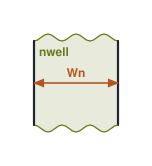

`examples/demo`, NW.1 — `Wn >= 0.8`: *nwell must be at least 0.8 µm wide.*

One rect (a wire). The two parallel edges that define the width are **straight**;
the other two are **wavy**. A measure `W` between the straight edges.
`A.layer == metal1` (match), `W >= 0.28` (check).
→ `metal1.width(0.28)`

### Min space (same layer)

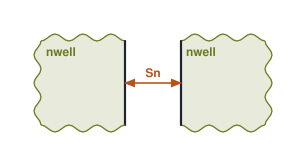

`examples/demo`, NW.2 — `Sn >= 1.0`: *any two shapes of nwell must be at least 1 µm apart.*

Two rects of the **same** layer, side by side. The two **facing** edges are
straight; a measure `S` across the gap.
`A.layer == metal1`, `B.layer == metal1`, `S >= 0.28`.
→ `metal1.space(0.28)`

### Min separation (different layers)
Same as space, but `B` is a **different** layer.
→ `metal1.separation(comp, 0.28)`

When one of two shapes of the *same* layer is a selected one — "the plate that holds a
top plate, to any other metal of its layer" (a link on that shape alone) — every
too-small space of the layer with such a shape on one side is reported:
→ `metal2.space(1.2).interacting(metal2.covering(fusetop))`

### Enclosure

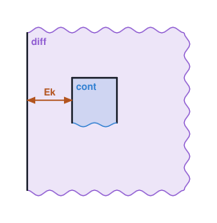

`examples/demo`, CO.4 — `Ek >= 0.1`: *diff must enclose square cont by at least 0.1 µm.*

An **inner** rect inside an **outer** rect. A measure `E` from the outer edge to
the matching inner edge (the margin).
→ `outer.enclosing(inner, 0.22)`

(When the inner one only *crosses* the outer, see *Extension / overhang / end cap*.)

With the arrow set to **within** ("… [Outside Not Allowed]") a margin of `E >= 0` says only
that the inner one must not lie across the outer one's edge:
→ `inner.overlapping(outer).not_inside(outer)`.

### Extension / overhang / end cap (one layer crossing another)

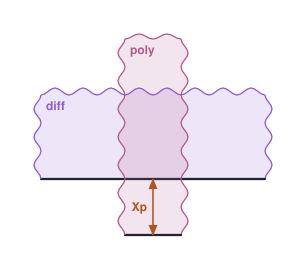

`examples/demo`, PO.2 — `Xp >= 0.2`: *poly must extend at least 0.2 µm beyond diff.*

"Poly2 must extend 0.22 beyond COMP", "COMP must extend 0.24 beyond the gate",
"salicide block must extend beyond unsalicided poly": draw the two layers the way
they sit — a **bar** and a **band crossing it** — and **one measure** from the edge
of one (where it lies inside the other) to the edge of the other. Nothing else.

The compiler reads two things off that picture:

- **where the measure lies** — inside `C` but outside `X` means "how far `C` reaches
  past `X`";
- **what covers each measured edge** — any other layer drawn over the stretch.

| the measure runs | means | compiler derives |
|---|---|---|
| from the band's edge (inside the bar) to the bar's end | the bar reaches past the band | `bar.enclosing(band, v)` |
| from the bar's edge (inside the band) to the band's end | the band reaches past the bar (an end cap) | `band.enclosing(bar, v)` |
| from one layer's edge to the other's, **inside both** | how deep they overlap | `a.overlap(b, v)` |

→ `comp.enclosing(sab, 0.22)` — "comp must extend at least 0.22 µm beyond sab".

**Butted regions.** For "N+ part of a diffusion butted to its P+ part must be at
least 0.22 long", draw **one** `comp`, `pplus` over one part, `nplus` butted against
it over the rest, and measure from the butting edge to the end of the `comp`. The
`nplus` covers the measured stretch but does not reach the `pplus` part, so it is
not combined into the diffusion — it says *where* the extension is looked at:
→ `comp.enclosing(pplus, 0.22).overlapping(nplus)` — "comp must extend at least
0.22 µm beyond pplus — only where the geometry is overlapping nplus".

A context **linked** to either shape still filters that shape
(`sab.outside(otp_mk).enclosing(poly2, 0.22)`).

### Min area


`docs/figures`, 1-any-shape — `A.area >= 0.1`: *metal must be at least 0.1 µm² in area.*

One closed rect with **all edges wavy** — it stands for "any polygon"; only the
total area is constrained, no edge is measured. `A.area >= 0.2025`.
→ `comp.with_area(nil, 0.2025)`

A maximum is written the same way, `A.area <= 10000`; an area exactly at a bound that
includes it (`>=`, `<=`) is not reported.

### Min void area (a hole / ring)
Draw the shape as a **donut** — an outer outline with an inner **hole loop**
(`hole_loops`) cut out — and measure *the void*, not the ring: `A.holes.area >= 0.35`.
`A.holes` is a genuine sub-feature of the drawn shape (like an edge's length), so the
compiler recovers "the layer's enclosed voids" from the drawn hole and the threshold
from the constraint. A min-void-area rule flags pinholes/slivers in a fill.
→ `nplus.holes.with_area(nil, 0.35)`

### A ring that must surround something
Draw it as the manual does: the guard ring as a **donut** and the thing it guards in its
hole. The check is `D in G.holes` — "must lie inside", said of the ring's void:
→ `dnwell.not_inside(pcomp.holes)` — *every dnwell must be surrounded by an unbroken
ring of pcomp.* A ring with a gap has no hole, so a broken ring is reported too.

### A check on the overlap of two layers (a device)
Draw **both real layers**, with the second one **covering the measured region**
(the part you measure sits inside it). You draw `comp` and `mos_cap_mk` — two
shapes. The compiler sees the second layer covers what you measure and *derives*
the combined layer for you.
→ compiler produces `comp.and(mos_cap_mk)`, then runs width/space/area on it.

### A check on a layer with a region removed
The mirror of the overlap case. Draw `otp_mk` as a **real shape inside** `comp`
(the part to remove) **with a real (straight) edge** — its boundary cuts `comp`, so
it's a device layer, not an all-wavy domain — and put the measured geometry on the
`comp` that is **not** under it. The compiler sees that what you measure sits
*outside* `otp_mk` and derives the subtraction. (No tagged hole — a real cutout.)
→ compiler produces `comp.not(otp_mk)`

**The part of a shape that sticks out of a layer (straddling).** When the layer you
cut out is *also* one the shape has a relation to — `nat` drawn overlapping
`dualgate`, with the `dualgate` part cut out of it — the relation is read on the
shape **as drawn, before the cut** (what is left after removing `dualgate` can no
longer overlap it). So the picture means "for a `nat` that overlaps `dualgate`, the
part left outside it":
→ `nat.overlapping(dualgate).not(dualgate)` — with a cross: "nat that overlaps
dualgate must not extend beyond it".

**Shapes that touch.** A minimum distance of exactly 0 — two shapes abutting — is a
violation unless the rule says otherwise (`E >= v or E == 0`). Some processes treat
abutting as always allowed; say it once with `"touching": "allowed"` in `process.json`
(or on a single rule), and every minimum spacing, separation and enclosure
reads "... or exactly 0".

**A family of layers (each on its own).** A manual often gives one set of rules for
several layers — "intermediate metal: metal2 and metal3". Name the family once, in
`process.json`: `"each": {"metalint": ["metal2", "metal3"]}`, draw the
shapes on `metalint`, and every rule that uses it is repeated for each member by
itself, named `RULE_metal2`, `RULE_metal3`. This is not a layer set: a set (below) is
*any of them together, as one material* — its spacing would be measured from metal2 to
metal3 as well.

**Several layers at once (a layer set).** When the same shape stands for *any of*
several layers, give it a set: `X.layer in {mvsd, otp_mk, ymtp_mk}` (or spelled out,
`X.layer == mvsd or X.layer == otp_mk or …` — the same thing). One cutout with
a set removes each member (`.not(mvsd).not(otp_mk).not(ymtp_mk)`); anywhere else the
set is the union of its layers (`.not_interacting(dualgate.or(v5_xtor))`).

> **Combine vs remove vs filter — read off the drawing, no special markup.** It
> comes down to *where `B` sits relative to your measurement*, and — when it's off
> the measurement — whether `B` is a device (a real edge) or a domain (all wavy):
>
> | `B` relative to the measurement | meaning | compiler derives |
> |---|---|---|
> | **covers** it | combine | `comp.and(B)` |
> | **off** it — a cutout inside the subject, with a real (**straight**) edge | remove | `comp.not(B)` |
> | **off** it — all wavy (a domain), inside or around the subject | filter | a scope (`.overlapping` / `.not_interacting` / `.interacting`) |
>
> A layer that **covers the measurement is always `.and(B)`** — the deck writes
> `.and` whether `B` is a true device or just a domain marker that happens to cover
> (they're equivalent there). The device-vs-domain question (real edge vs all wavy)
> only matters when `B` is **off** the measurement: a real edge = a device being
> cut out (remove); all wavy = a domain marker (filter).

### Restrict the subject by a relationship to another layer


`docs/figures`, 4-link — `W >= 0.4` and a link from the diff to the well: *diff that lies inside well must be at least 0.4 µm wide.*

Draw a **context shape** of that other layer and a **link** from the subject to it:
a measure drawn to a wavy edge. A link is not a distance, so it needs **no
constraint** (an old-style `G >= 0` on it is accepted and adds nothing). The *relation* you draw is what the compiler reads — it derives the
selection op:

| what you draw (subject vs context) | compiler derives |
|---|---|
| subject **inside** the context | `X.inside(Y)` |
| **disjoint** (drawn apart; the gap may be zero) | `X.outside(Y)` |
| **touching** (coinciding edges — one shape's edge *is* the other's) | `X.interacting(Y)` |
| **overlapping** (interiors cross) | `X.overlapping(Y)` ≡ `X.not_outside(Y)` |
| the context drawn **wholly within** the subject | `X.covering(Y)` — "the metal that holds a top plate" |

The **exact relation you draw is the signal** — `touch` and `overlap` are different
pictures with different meanings. A *touch* (coinciding edges) counts as
`interacting`; a genuine *area overlap* is `overlapping` (equivalently
`not_outside` — "not wholly outside" = has overlap). To get `outside` you draw the
shapes **apart** (disjoint); a linked "apart" still allows the gap to reach zero. This matches the scope table below exactly (touch→`interacting`,
overlap→`overlapping`) — selection and scope read relations the same way.

The **link is the signal** that this is a *selection*: drawing one to a layer makes it a *selection*
(`X.inside(Y)`, keeping whole polygons). The *same* containing layer drawn with **no
measure** — just covering — would instead be a *combine* (`X.and(Y)`, the
overlap-of-two-layers recipe above). They're behaviourally close when the subject
is inside `Y`, but the link is what tells them apart. Apply the link to
**each** subject shape (both rects of a space rule), and you can chain several
(`X.inside(A).inside(B)`). The separation **argument** can be selected the same
way: a link from `B` to its context → `X.separation(Y.outside(Z))`.

**A link between the two measured shapes.** A space arrow between A and B, and beside it
a link (to a wavy edge) from A to B: A is one that lies **outside** every B — "the drift
region to an NCOMP *outside* the drift", which leaves out the source the drift itself
reaches under: → `mvsd.separation(ncomp.outside(mvsd), 4)`.

**A filter on a second arrow.** An arrow from the checked shape to a third shape that the
check does not measure, with a filter `Y < 1.0` on it: the rule is about those of the
checked shape that have such a third one that near — "where the Nwell is less than 1 µm
from the NCOMP, a tap within 20": → `ncomp.overlapping(nwell.sized(1)).not(tap.sized(20))`.

### A selected marker (the context has its own selection)
The context shape itself can be a *selected* thing —
`via1.interacting(metal2.interacting(fusetop))` = "a via1 touching a **metal2 that
itself touches fusetop**". You draw it by giving the **context its own context**:
draw the marker `metal2` in its relation to the subject (a link), then draw
`fusetop` in its relation to the *marker* with **another link from the marker
to it**. The compiler reads the inner relation back onto the marker, producing the
nested `metal2.interacting(fusetop)`. The marker can also be a **device** — give it
a wholly-covering doping layer and the marker becomes `comp.and(pplus)` (a P+
diffusion), so `pcomp.inside(nwell)` is "draw a comp, dope it pplus, put it in a
well." A marker can also carry a **cutout** (`poly2.not(v5_xtor)`) — draw a hole of
that layer inside the marker, same as a NOT on the subject. And `inside(A&B&C)` is
the same as `inside(A).inside(B).inside(C)` (a polygon inside the intersection is
inside each operand), so a multi-layer `inside` context is just **several `inside`
selections** — draw a containing context per layer.

### Negated selections (`not_inside`): label several instances
The positive selections above are each a *single* relation — one picture. A
**negation** like `not_inside(Y)` ("keep the X polygons **not** wholly inside Y")
has no single positive picture: it keeps a whole *family* of relations (outside,
touching, straddling) and drops only one (wholly inside). So you draw the subject
layer **more than once** and **label** each instance flagged (a violation) or not:

- the **flagged** instance carries the check/measurement (the violation), drawn in
  a kept relation — e.g. the subject **outside** Y, and a second copy **straddling**
  Y's edge;
- a **not-flagged counter-example** — the same layer drawn **wholly inside** Y —
  shows the relation that is *carved out*.

A selection is really a **partition of relations into flagged / dropped**, and
every op is a distinct row of this table (✓ = that relation is kept):

| op | inside | disjoint | touch | overlap |
|---|---|---|---|---|
| `inside` | ✓ | | | |
| `not_interacting` | | ✓ | | |
| `outside` | | ✓ | ✓ | |
| `overlapping` ≡ `not_outside` | ✓ | | | ✓ |
| `interacting` | ✓ | | ✓ | ✓ |
| `not_inside` | | ✓ | ✓ | ✓ |

The compiler reads the relations of the labeled instances (inside → dropped,
disjoint + overlap → kept) and **looks up the matching row** → `X.not_inside(Y)`.
You only draw the extra counter-example(s) for a **negation**; a positive
selection stays a single flagged instance (everything else dropped by default).
Nothing here is derived — just the subject layer drawn a few times in its natural
relations, each labeled.

### Restrict a rule to a domain / region (a marker layer)
Draw a marker-layer rect **around** the subject, with **no measure** (fully
separate). The compiler derives the scope op from the relation:

| what you draw (no measure) | compiler derives |
|---|---|
| disjoint | `.not_interacting(marker)`  (e.g. 3.3 V domain) |
| overlapping | `.overlapping(marker)`  (e.g. 5 V domain) |
| touching | `.interacting(marker)` |

> **Unlinked vs linked** is the deliberate distinction between a **scope marker**
> (it restricts where *violations* are reported: `not_interacting` drops touching)
> and a **selection** (it restricts which *shapes* are checked: `outside` keeps
> touching). The link is the signal, and the editor shows each shape's role.

**A marker that holds something.** A marker with a shape drawn inside it and a link from
the marker to that shape is a marker *that holds one*: "a DNWELL with its NCOMP tab" →
`dnwell.covering(ncomp)`. A marker of the same layer as one the measured shape is drawn in,
but drawn apart from it, is **another** one: `….not_interacting(<the measured layer>)`.

**A guard between the two.** A minimum distance whose arrow passes right **through** a
third shape lying apart from both: where that shape lies across the whole way between
the two, the rule is lifted — "a DNWELL guard ring is needed between the LDPMOS drift and an
NCOMP less than 40 µm away": → `drift.separation(ncomp, 40).polygons.not(dnwell.covering(ncomp)…)`.
The generated self-test also draws the guard too short to part all of the one from all
of the other, which must report.

### Acute angle
"No acute angles" is a rule about **corners**: two **straight** edges meeting at a
sharp corner. Draw such a corner and write the check on it — what must hold:
`a1.corner >= 45` (`<edge>.corner` is the angle **between** the two edges meeting
where that edge starts: a right angle is 90, an acute corner less). The corners that
fail it are flagged.
→ `comp.with_angle(0 .. 45)`

(A forbidden *range* that has no single assertion — "no corner between 30° and 60°" —
is written as a filter: match `a1.corner >= 30 and a1.corner <= 60`. The older
spelling on an edge's direction, `a2.angle > 0 and a2.angle < 45`, still compiles to
the same op.)

### Corner
A shape with a corner (two adjacent straight edges) and a constraint on its angle.
As everywhere, the kind decides: the check `a1.corner != 90` ("no right-angle
corners here") flags the 90° corners; the check `a1.corner == 90` flags every corner
that is *not* 90°; as a filter (match), `a1.corner == 90` selects the 90° ones.
→ `poly2.corners(90).sized(0.1).or(poly2.corners(-90).sized(0.1))`  (both convex
and concave 90° corners).

`corners()` returns the corners as zero-area **points**, so the `.sized(0.1)`
inflates each into a small 0.1 µm marker box so it can be output (the corner
analogue of `.extended` for edges). That `0.1` is **not drawn** — it's a fixed
backend constant (a marker-box size, matching the deck); it doesn't change *which*
corners are flagged, only that they're outputtable.

### Edge length
A shape with a **straight** edge; constrain its length. The constraint's **kind**
decides the reading, exactly as for every other constraint:

As a **`check`** (what every edge must satisfy — the edges that *fail* are flagged):

| check | flags | compiles to |
|---|---|---|
| `e.length == 0.22` | edges that are not 0.22 | `layer.edges.without_length(0.22)` |
| `e.length != 0.22` | edges that are exactly 0.22 | `layer.edges.with_length(0.22)` |
| `e.length >= 0.34` | the shorter edges | `layer.edges.with_length(nil, 0.34)` |
| `e.length <= 0.5` | the longer edges | `layer.edges.with_length(0.5, nil)` |
| `e.length >= 0.1 and e.length <= 0.5` | edges outside the range | `layer.edges.without_length(0.1, 0.5)` |

As a **`match`** (a filter — the edges that *satisfy* it are selected):

| match | selects | compiles to |
|---|---|---|
| `e.length <= 0.34` | edges up to 0.34 | `layer.edges.with_length(nil, 0.34)` |
| `e.length == 0.22` | edges of exactly 0.22 | `layer.edges.with_length(0.22)` |
| `e.length >= 0.1 and e.length <= 0.5` | edges in the range | `layer.edges.with_length(0.1, 0.5)` |

A length filter usually qualifies another rule (an end-of-line, below). A rule that
has only filters and no check flags what the filters select.

**The edge two shapes share.** A length on a straight edge drawn ON an edge of another
shape (two shapes of different layers butting) is the length of the stretch they share:
"minimum length of a butting edge" is NCOMP and PCOMP drawn butting and
`nc_1.length >= 0.3` → `ncomp.edges.and(pcomp.edges).with_length(nil, 0.3)`.

### End-of-line (a wire end)


`docs/figures`, 3-line-end — filters `line_0.length <= 0.34`, `line_1.length >= 0.28`, check `R >= 0.06`.

A min-width wire is *two straight sides + wavy ends*. An **end-of-line** rule is that
same wire with **one end made real**: draw the **cap** (the short end edge) **straight**
while the *other* end stays **wavy** ("the wire continues"), keep the two sides straight,
and add two edge-length **filters** (`match`) — `cap.length <= Weol` (the EOL width) and
`side.length >= Slen` (the min run length): they say *which* wire ends the rule is
about. Put the rule measure on the cap (e.g. an inner contact it must enclose) — its
bound (`R >= 0.06`) is the one **check**. No new primitive, no to-scale drawing: the cap-opposite-
a-wavy-end geometry *is* the end-of-line, and the compiler emits KLayout's idiom:
→ `cond = metal1.drc(width <= Weol).with_length(Slen, nil, both)`
→ `eol = metal1.edges.with_length(nil, Weol).interacting(cond.first_edges).interacting(cond.second_edges).not(cond.first_edges).not(cond.second_edges)`
→ `eol.enclosing(contact.edges, 0.06)`

### Halo (a "within X" margin on a shape)
A shape carries an optional **halo** — a signed margin (default 0) its region is
**grown** (halo > 0) or **shrunk** (halo < 0) by, the formal form of a DRM figure's
dashed offset line ("within X of"). Draw it as a **dashed/dotted offset outline**
(outside the shape for +, inside for −). A `rounded` tick selects rounded vs square
corners on the grown region (reserved — not yet rendered to KLayout). The compiler
appends it to that shape's derived region:
→ `nwell.outside(dnwell).sized(0.429.um)` (a nwell-outside-dnwell region grown 0.429)

### Min/max size (contact/via) — edges as the output
A contact/via must be *exactly* the right size, so any edge of the **wrong length**
is a violation. Draw the layer with a straight edge and the check `e.length == 0.22`
(what must hold); the edges that fail it are flagged, rendered as thin polygons via
`.extended` so they're outputtable:
→ `contact.edges.without_length(0.22).extended(0, 0, 0.001, 0.001)`

### Shape class — squares and bars (comparing two sides)

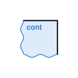

`examples/demo`, CO.1 — filter `ka_0.length == ka_1.length`, check `ka_0.length == 0.2`: *every square cont edge must be exactly 0.2 µm long.*

Manuals often split one layer by the *kind* of shape: "contact" is the square one,
"contact bar" the long one, each with its own rules. Say it the way the figure does —
by how two **sides of the same shape** compare. It is a filter (`match`), so it narrows
the layer wherever that shape is used in the rule (a size, a spacing, an enclosure):

| match | the shape stands for | compiles to |
|---|---|---|
| `k0.length == k1.length` | the squares of its layer | `layer.squares` |
| `k0.length > k1.length` (or `<`, `!=`) | the others — bars | `layer.non_squares` |

Once two sides are ordered, they are the shape's **long** and **short** side, and a
length constraint on one of them is about that extent of the whole shape (one answer
per shape), not about every edge:

| with `k0.length > k1.length` | flags | compiles to |
|---|---|---|
| check `k1.length == 0.16` (bar width) | bars whose short side is not 0.16 | `layer.non_squares.without_bbox_min(0.16)` |
| check `k0.length >= 0.34` (bar length) | bars shorter than 0.34 | `layer.non_squares.with_bbox_max(nil, 0.34)` |

Written as a **`check`**, the comparison is the rule itself: `k0.length == k1.length`
means "must be square" and flags `layer.non_squares`.

Ordered with `>=` (`k0.length >= k1.length`) the two sides are still the long and the
short one, and a square is not left out. A filter on the shape's **area** beside the
check says which shapes are meant: `match D.area > 15000` with `check k1.length <= 80`
— *the shorter side of every ndmy of more than 15000 µm² must be at most 80 µm.*

**A rectangle** is the shape with four corners: `F.corners == 4`. As a check it is
"must be rectangular" (→ `layer.non_rectangles`); as a filter the shape stands for the
rectangles of its layer (`layer.rectangles`; `F.corners != 4` for the others).

### Nets — "different potential", "same net"


`examples/demo`, NW.3 — filter `NA.net != NB.net`, check `Sn >= 2.0`: *any two shapes of nwell must be at least 2 µm apart where the two are on different nets.*

Some spacings depend on whether the two shapes are electrically connected. Say it as a
filter between the two measured shapes:

| match | the rule is about | compiles to |
|---|---|---|
| `A.net != B.net` | pairs on different nets ("different potential") | `nwell.nets.space(1.4, euclidian, props_ne)` |
| `A.net == B.net` | pairs on the same net | `… props_eq` |
| (nothing) | every pair — the usual "equi-potential" minimum | `nwell.space(0.6)` |

What makes a net is process knowledge — which layers are one net where they touch —
and is given **once**, in `process.json`:

    "connect": [["nwell", "ntap"], ["ntap", "cont"], ["cont", "met1"]]

(In a drawing it can also be stated as a fact: two shapes of different layers drawn
touching or overlapping with `K.net == D.net` mean "these layers connect"; between
shapes drawn *apart* the same equality is a filter, as in the table above.)

Legend names such as `ncomp` may be used. The deck declares the connections before
the rules.
A well with no tap at all is a net of its own. `fastdrc rules` warns if a rule speaks
of nets and no `connect` list is given.

**Two at different potentials in one holder.** Two shapes of a layer drawn inside one
other shape, the filter `A.net != B.net` and a **cross** on the arrow between them:
"two or more COMPs connected to different potential are not allowed under the same NAT"
— every holder whose shapes of that layer are on more than one net is reported, with
all of them (the deck looks the nets up per holder; no distance is involved).

### Counts — "must contain exactly n"

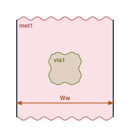

`examples/demo`, V1.2 — filter `Ww >= 2`, check `Count(VW) >= 2`: *every met1 at least 2 µm wide must hold at least 2 via1.*

`Count(K)` is a function in a constraint: how many shapes of K's layer a shape
holds. *Which* shape is read from the picture — the one K is drawn in. Draw the pad
with one via in it and write:

| constraint | flags / selects | compiles to |
|---|---|---|
| check `Count(V) == 4` | pads that do not hold exactly 4 vias (none included) | `pad.not_interacting(via, 4, 4)` |
| check `Count(V) >= 2` | pads holding fewer than 2 | `pad.not_interacting(via, 2)` |
| check `Count(V) <= 8` | pads holding more than 8 | `pad.interacting(via, 9)` |
| match `Count(V) >= 4` | (a filter) the pad stands for pads holding at least 4 — "pads with 4 or more vias must be 2 µm wide" | `pad.interacting(via, 4).width(2)` |

Everything that touches or overlaps the holder counts, a via lying across its edge
included.

Counted shapes may be filtered like any others: with `match V.rows >= 2 and V.columns >= 2`
on the via (and `match S < 0.36` on the arrow to its neighbour — how close makes an
array), `Count(V) >= 1` reads "must hold a 2 × 2 array of vias".

**In a ring's hole.** A shape drawn in the void of a ring is held by the hole: `Count(D) == 1` with D in the hole
of a guard ring G is "every hole of G must hold exactly one D" (→ `G.holes.not_interacting(D, 1, 1)`). A filter
`match Count(D) >= 1` makes it the holes that hold a D at all. A counted shape is narrowed by the links drawn
FROM it to the other shapes held: an Nwell linked as drawn apart from the DNWELL counts the Nwells outside it.
`Count(K) == 0` is "must hold none" (→ `.interacting(K)`). The holders can be named **through what is
counted**: a counted shape drawn touching the holder and linked on to a shape that carries a count filter of its
own — `match Count(G2) == 2` on the source between two gates — makes the check "a drain next to a gate whose source
is shared by two gates must lie between two gates" (→ `mvsd.interacting(gate.interacting(source.interacting(gate,
2, 2))).not_interacting(gate, 2, 2)`). Counted in a ring's hole, a counted shape linked to a neighbour that is
linked to a layer **grown** a little (`pcomp + 0.005`) counts only those whose neighbour does not butt that layer:
"every two fingers in a guard ring, unless each source butts a tap". A filter `match Count(K) >= 1` on a plain
holder narrows it the same way: with the check `Count(V) >= 1` on arrayed vias it is "metal that carries a via
must carry a 2 × 2 array of them" (→ `metal.interacting(via, 1).not_interacting(via_array_2x2, 1)`).

`Area(K)` is its companion: how much **area** of K's layer the shape holds, all of it
together, in µm². "The MIM capacitors on one bottom plate may be 10000 µm² in all" is
the plate with a capacitor in it and `Area(F) <= 10000`.

### A share of a shape's area — what it holds
"Slit density of a metal plate at least 6 %": the area of what a shape **holds**,
relative to its own. Draw the slit inside the plate and bound one area by the other:

    S.area >= 0.06 * P.area        (or  S.area / P.area >= 0.06;  <=  for a maximum)

A sum on the left takes several layers together. Each plate is judged on its own, and
a plate holding nothing at all fails a minimum. Filters on the holder apply as usual —
"any plate bigger than 35 µm" is a width arrow on the plate with the filter `W >= 35`.
→ the holders, what lies in each, and `evaluate_nets(…, "put('r', area(a) / area)")
.selected_if("value('r') < 0.06")`.

This is by *containment*, read from the drawing. Two shapes joined by connections
(nets) with the same kind of constraint are an antenna rule, next.

### Antenna ratio — area collected per connected gate area

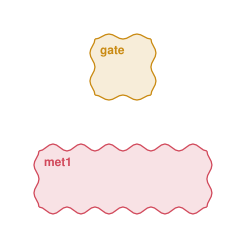

`examples/demo`, AN.1 — `MP.area <= 400 * GA.area`: *the area of met1 connected to gate must be at most 400 times the area of that gate.*

During processing a conductor collects charge that can only leave through the gates
it is connected to. Draw the gate and the conductor connected to it (through the drawn
stack, see nets above) and bound one area by the other:

    M.area <= 400 * G.area        (or  M.area / G.area <= 400)

→ `antenna_check(gate, met1, 400.0)`.

The rule sees the stack only **up to its own layer**: for a metal-1 rule, via-1 and
metal-2 are not there yet. The order of the stack is read from the drawn connections —
a layer's level is how many connection steps it is from the gate (poly and the
contacts on it, then metal-1, via-1, metal-2 ...) — and the deck declares just the
connections between layers no further out than the rule's own.

Two refinements, both read from the same picture:

| you write | means | compiles to |
|---|---|---|
| `(M1.area + M2.area) <= 200 * G.area` | the layers together — a *cumulative* ratio; each layer's share is taken at its own stage | one `evaluate_nets(...)` per layer as the connections are added, then the nets whose sum is too large |
| a `match` on another connected shape: `D.area < 0.16` / `D.area >= 0.16` | only nets *without* / *with* that much of it — a protection diode | the same, with the condition on the finished stack |

### Density — how much of an area a layer covers

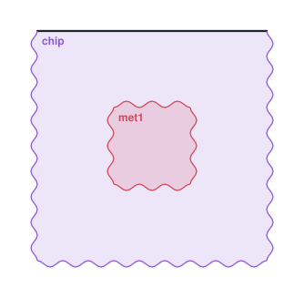

`examples/demo`, DN.2 — `MN.density <= 0.9`, the window given a side and a step: *met1 must cover at most 90 % of every 100 × 100 µm window (stepped by 50 µm) of chip.*

Draw the material and say how much of the area it must cover:
`M.density >= 0.35`, `M.density <= 0.6` (a fraction, or a percentage: `>= 35`). Where
the density is taken is read from the picture:

| you draw | the density is taken | compiles to |
|---|---|---|
| the material alone | over the whole layout | `(M.area < 0.35 * extent.area) ? extent.dup : polygon_layer` |
| the material inside a shape on a boundary layer (`W.layer == chip`) | over that layer | the same, with `chip` |
| ... and that shape given a side length (`w0.length == 800`) and a step (`W.step == 400`) | in every window of that size, stepped across the area | `out_of_density.call(M, 0.0 .. 0.65, chip, 800.0, 400.0)` |

The marker is the area (a global rule) or each window that is out of range. Windows
start at the lower-left corner of the area and never reach outside it; where the last
step stops short of the far edge, one more row / column is laid against that edge. A
window exactly at the limit passes. An area only one window wide or tall is
measured window by window (KLayout's own tiling returns nothing for a single row). The deck carries the small `out_of_density` helper
once, at the top.

### "On one of two adjacent sides" — either of two arrows is enough

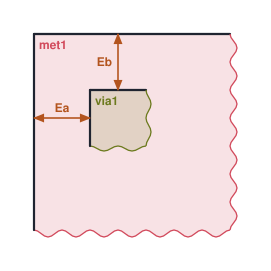

`examples/demo`, V1.1 — `Ea >= 0.1 or Eb >= 0.1`: *met1 must enclose via1 by at least 0.1 µm on at least one of any two adjacent sides.*

Via and contact enclosures are often stated per side: *enclosed by 0.06 on one of two
adjacent sides* (equivalently: on two opposite sides), the *endcap* enclosure. Draw the
inner shape near a corner of the outer one, an arrow on each of two **adjacent** sides,
and one check joining them with `or`:

    Ea >= 0.06 or Eb >= 0.06

The shape fails where two of its sides that meet at a corner both fall short (a side
falls short if any part of it does):
→ `via.interacting(met.enclosing(via, v, projection, whole_edges).second_edges.width(angle_limit(100), 1.dbu).polygons(0.001))`

The two values may differ — *if the overlap is less than 0.04 on one side, the adjacent
sides need 0.06*: `Ea >= 0.04 or Eb >= 0.06`. A side short of the smaller value that
meets, at a corner, a side short of the larger one is the violation (which arrow carries
which value does not matter).

The same form works for a spacing in two directions — "the spacing is only required in
one direction": arrows to the neighbour beside and the neighbour above, `Sx >= v or
Sy >= v`. (`E >= v or E == 0` on a *single* arrow is something else: coinciding edges
are allowed.)

### Arrays — "spacing in an N × N or larger array"

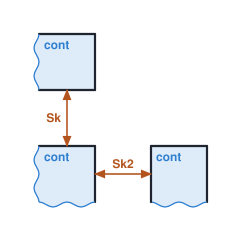

`examples/demo`, CO.3 — `Sk >= 0.3 or Sk2 >= 0.3`, each contact filtered to arrays of 4 × 4 or more.

Draw two neighbours of the array with the spacing arrow and its check, and say with a
filter on each that it sits in an array: `match K.rows >= 4 and K.columns >= 4`
(`> 4` for "more than 4"). Two more filters make it exact, both read off the same
picture:

| filter | says | if left out |
|---|---|---|
| `k0.length == 0.22` (a side of the element) | how big one element is | the array is taken by **count** (at least rows × columns shapes in the group) |
| `S < 0.36` on the spacing arrow | how close neighbours must be to count as one array | the checked spacing itself |

Shapes that close to one another form a group; a group at least N elements across
is wider than N−1 elements could ever span inside a group, so the parts of the group
that wide in both directions are the large array, and the shapes inside it are checked:
→ `K.inside(K.sized(g/2).sized(-g/2).sized(-t/2).sized(t/2)).space(v)`
with `g` the grouping distance and `t = (N−1)·size + (N−2)·g`. Rows and columns may
differ (rows are counted along y). Taken by count (no element size), the group is the
shapes joined by what lies between two of them facing each other closer than `g`:
→ `K.inside(K.or(K.space(g, projection).polygons).interacting(K, rows·columns))`

### The whole layer, although something lies under it in the picture
A shape normally means "this layer *here*": whatever is drawn under the spot where
the arrow touches it combines with it (poly over diffusion is read as the gate). When
the rule is about the layer wherever it is — "contact on diffusion, space to **poly**",
drawn at a transistor because that is where it matters — mark the shape as the whole
layer (`"whole": true` on the shape):
→ `cont.and(diff).separation(poly, v)` instead of `…separation(poly.and(diff), v)`.
Manuals usually say which they mean ("poly **on diffusion**", "gate" vs just "poly").

### Two layers that meet because one is cut out of the other
If the legend defines one layer as what is left after removing another
(`"ndiff": "diff and not pimp"`), the two share an edge wherever the cut runs — a
butted tap. That is the definition, not a spacing of zero, so a spacing rule between
them ignores the shared edge and still flags every real gap that is too small:
→ `pimp.separation(ndiff, v).polygons` (no 1 nm widening of zero-width pairs).

### Gate width (poly over the gate) — a directional edge width
A transistor gate is a **poly line crossing a comp region**; the channel width is
the poly width *at the crossing*. Draw the poly `A` (its two measured edges
**straight**), and a `comp` rect that **crosses** it (a partial overlap — comp runs
*through* the poly, as a real gate does). The compiler reads that crossing relation
and derives the gate `tgate = poly2 & comp` as the edge-marker. Mark the width as an
**edge** measure (a directional, edge-to-edge distance, not a polygon width). Two
neighbours are told apart **by how they sit on the subject**, exactly like combine
vs filter elsewhere:

| what you draw, relative to the poly | compiler derives |
|---|---|
| a layer **crossing** it (partial overlap) | the **gate** — `.and((poly2 & it).edges)` |
| a mask layer **containing** it (full cover) | a **region filter** — `.and(mask)` |
| a cutout **inside** it (real edge) | **remove** — `.not(cut)` |

→ `poly2.edges.and((poly2 & comp).edges).not(otp_mk).and(ymtp_mk).width(0.13)`

An edge measure between **two** shapes reads the way they sit: apart, the edges of one
to the edges of the other (`a.edges.separation(b.edges, v)`); one inside the other,
the outer one's edges around the inner one's (`outer.edges.enclosing(inner.edges, v)`).
Use it when a rule holds only in part of the plane — "N+ must reach 0.16 µm past COMP
*within 0.43 µm of the well edge*": the zone covers the picture, and what is measured is
the COMP's edge in that zone, not a polygon cut off at the zone's boundary.

**Which edge is meant.** "Poly extension beyond COMP in the width direction (other than
towards the drain)" is about some edges of the diffusion and not others. The picture
already says which: put the arrow on that edge and mark it as measured on edges
(`"edges": true`). An edge drawn **running out from under** the other shape — one end
under the gate, one outside — stands for the edges that do so; an edge drawn **wholly
under** it stands for those:
→ `poly2.edges.enclosing(comp.edges.interacting(poly2.edges).and(poly2), 0.4)` (running out: the part of
such an edge that lies under the gate), or
`….not_interacting(poly2.edges)` (lying under).

The same for an enclosure measured on edges: another shape drawn with a **straight**
edge crossing some edges of the outer shape and not others tells them apart, and the
measured edge is of one kind — "MVPSD enclosing the drain, in the drain direction and
along the width" is every drift edge the channel diffusion does *not* cross:
→ `mvpsd.edges.not_interacting(comp.edges).enclosing(comp.edges, 0.8)`
(Crossing a wavy edge says nothing: a wavy edge is an arbitrary boundary.)

**A maximum from every edge.** `S <= 15` on an arrow measured on edges, between two
shapes drawn apart: every edge of the shape the arrow starts at must have the other one
facing it within 15 — "the tab at most 15 µm from the device's edge" holds on each side:
→ `A.edges.not_in(A.separation(B, 15.001, projection, whole_edges).first_edges)`

A length **filter** on that starting edge says which edges: `match a_1.length > 0.62` —
"each long side of the anode must have a cathode facing it" (the ends are not long sides).
With the metric `projection` on the arrow, **all** of each such edge must be faced (a
cathode shorter than the anode leaves a stretch unfaced): → `A.edges.with_length(0.621, nil)
.not(A.separation(B, 0.281, projection).first_edges)`.

**At a butting edge.** An arrow measured on edges whose starting edge is drawn ON an edge of another shape (an
implant edge drawn on a diffusion's edge) starts at the shared edge only: "Nplus space to the P-gate at a butting
edge" → `nplus.edges.and(pcomp.edges).separation(pgate.edges, 0.32, projection)`.

**Which way a gate runs.** A check on a straight edge's direction — `g.angle == 0`,
"must run along x" (90: along y) — flags the gate edges that run any other way:
→ `poly2.edges.and(tgate.edges).without_angle(0)`

As a **filter** the direction says which edges an edge width or space is about:
`match g.angle == 45 or g.angle == 135` with `W >= 0.3` between the two slanted edges of
a gate is "45-degree bent gate width" → `(gate_edges.with_angle(45) +
gate_edges.with_angle(-45)).width(0.3)`.

### Maximum bounds and narrow-region selectors (`.drc`)
A bound on a distance reads by its **kind**, like every constraint.

As a **`check`** (what must hold — where it fails is flagged):

| check | flags | compiles to |
|---|---|---|
| `W >= 0.28` | the narrower | `metal1.width(0.28)` |
| `W <= 5` | the wider (a *maximum* width) | `metal1.sized(-2.5).sized(2.5)` (what is left after taking half the value off every side) |
| `W >= 0.28 and W <= 5` | both | the two checks above |
| `S <= 20`, the arrow between the two **facing** edges of A and B | every A with no B within 20 — "must have a tap within 20 µm" | `A.not_interacting(B.sized(20))` |
| `S <= 20`, the arrow from B **through** A to its far side | every part of A farther than 20 from any B — "any portion within 20 µm of a tap" | `A.not(B.sized(20))` |
| the same, B combined with a layer it lies in (`ncomp and nwell`) | the reach stays in that **same piece** of it: a tap in the next well does not count | `A.not(B.sized(20).and(nwell).interacting(B))` |
| `E <= 6` (inner inside outer) | the parts of the outer reaching more than 6 beyond the inner | `outer.not(inner.sized(6))` |

**Exactly** — a manual's "Min/Max" on one arrow — is `E == 0.1`: the minimum and the
maximum together, each read as in the table. On the depth two layers **overlap** by, the
maximum flags an overlap deeper than the value (`A.and(B)` with half the value taken off
every side, and what is left grown back). `S == 0` between two shapes drawn apart says
they must **abut**.

Where the arrow is drawn says what is exact:

| the picture | says | compiles to |
|---|---|---|
| `L == 5.53`, the arrow from one end of a shape that is not a box to its other end | the shape is exactly that long from end to end | `layer.without_bbox_max(5.53)` (`_min` if the arrow runs across its shorter extent) |
| `E == 1.04`, two shapes drawn **abutting**, the arrow between their sides that run away from the shared edge | the wider one's edge goes on exactly that far beside the narrower one, on each side (a fuse link in the middle of its pad) | `pad.edges.interacting(link).not(link.edges).without_length(1.04)` |
| `E == 0`, one shape drawn inside the other | the two outlines **coincide**: neither reaches beyond the other | `outer.not(inner).or(inner.overlapping(outer).not(outer))` |
| `E == 0.2` on an extension measured on **edges**, from an edge that lies under the outer layer | the outer layer ends exactly that far past that edge, straight out from it | the minimum, and `edge.extended_out(0.201).not(edge.extended_out(0.2)).and(outer)` |

What covers the measured edges combines as always: a marker's edge and a salicide block's
edge both measured where they cross a poly line are those of `res_mk and poly2` and
`sab and poly2` — "RES_MK is exactly as long as the resistor".

A maximum between two shapes is read by **where the arrow ends**. Between the facing
edges it says the shape needs a partner within reach; the arrow starts at the shape
that needs it. Drawn through a shape to its far side it says *every part* of that shape
must be within reach, so the far end of a long shape is flagged; there the shape the
arrow crosses is the one meant, whichever end the arrow was started from. (This distinction was
found by the generated self-test: an arrow between the near edges, exactly at its
limit, was still reported by the "every part" reading.)

As a **`match`** (a filter — it *selects* the region that satisfies it; a rule with
only filters flags what they select):

| match | compiles to |
|---|---|
| `W <= 0.34` | `metal1.drc(width <= 0.34)` |
| `S <= 0.3` (same layer) | `metal1.drc(space <= 0.3)` |
| `S <= 0.2` (diff layers) | `metal1.drc(separation(comp) <= 0.2)` |
| `E <= V` (inner inside outer) | `via.drc(enclosed(metal) <= V)` |
| `0.04 <= E < 0.06` | `via1.drc(0.04 <= enclosed(metal1) < 0.06)` |
| `W >= 2` | `metal1.drc(width >= 2)` |

(A "greater than" predicate on a width is KLayout's: it returns the edges that have no
partner within the distance — checked on straight and L-shaped lines around the limit.)

### A configuration that must never exist (the cross)
Most rules check a *quantity* ("this distance is too small"). The other half of DRC
forbids a *configuration outright* ("these two must never overlap"). You draw the
forbidden picture and put a **cross** on it. The cross **is the rule's check**: a
measure whose bound is **"never"** (not `>= V`), so it needs no constraint of its own.

**A cross on a relation** — drawn between an edge of the subject `A` and an edge of
another shape `B` — forbids *that relation*. The compiler reads the drawn relation
exactly like a selection (`rel_to_sel`); the shapes selected are the violation:

| what you draw (A vs B) | how you mark it | the violation | reads as |
|---|---|---|---|
| **disjoint** (a gap) | cross **in the gap** between the two edges | `A.outside(B)` | A must **overlap** B |
| **touch** (edges coincide) | cross drawn **over the shared edge** (an X on it) | `A.interacting(B)` | A must **not touch or overlap** B |
| **overlap** (interiors cross) | cross over the overlap | `A.overlapping(B)` | A must **not overlap** B (touching OK) |
| **inside** | cross, A drawn inside B | `A.inside(B)` | A must **not be inside** B |
| **contains** | cross, B drawn inside A | `A.covering(B)` | A must **not contain** B |

Every *other* relation of the subject stays an ordinary filter (a plain link), so a
rule reads straight off the picture: **NW.6** "an Nwell resistor must stay out of
DNWELL" is an `nwell` drawn inside `res_mk` (a link — *which* nwell) touching a
`dnwell` with the **cross on that contact** (the check):
→ `nwell.inside(res_mk).interacting(dnwell)` — "nwell that lies inside res_mk must not
touch or overlap dnwell".

**Two things that must not share a holder** — "3.3 V and 5 V PMOS cannot sit in the same
Nwell" — is the well with one of each drawn in it: a link to the first (which wells),
the cross on the arrow to the second, and each gate linked to what tells them apart:
→ `nwell.covering(pgate.inside(dualgate)).covering(pgate.outside(dualgate))`

**A cross on the subject alone** — across its own two parallel edges, like a width
whose bound is "never" — forbids the subject's *region* itself: the layer as combined
by its covers and cutouts, in whatever relations are drawn as filters. Use it when
the forbidden thing is an overlap *region* rather than a relation: "salicide block
over a contact" is `sab` drawn under a covering `contact`, crossed.
→ `sab.and(contact)`

The flagged region *is* the output (no `width`/`space` op, no threshold).

> **Why the X sits on the edge for the touch case.** Start from the disjoint picture
> (cross *in the gap* between A's edge and B's edge). Now slide B until those two
> edges **coincide** — A and B now touch. The cross was *between* the two edges, but
> they're now at the same place, so it has nowhere to live — you draw it **across the
> coinciding edge** (an X over the contact). That X-on-the-edge is the natural mark
> for "this contact is forbidden": touch → `interacting` → must not touch.

The gap *size* never matters (close vs far are both "disjoint" → same rule); a cross
has no distance. For a distance bound, use a normal `>= V` measure instead.

> **Future extension — a directional cross.** Today the cross reads the *shape*
> relation, so which specific edges you pick doesn't change the result. If a rule ever
> needs "*this particular* edge of A must abut B" (a directional contact), letting the
> cross read the **edge pairing** (not just the shapes) is the clean way to express
> it — the same way straight edges already carry orientation for angle/corner rules.

### A rule with two alternative cases (OR)
Some rules count more than one configuration as the same violation. E.g. **NP.11**
forbids butting nplus/pcomp *"within 0.43 µm of the Nwell edge (outside DNWELL) and
of the LVPWELL edge (inside DNWELL)"* — two different cases (different reference
layer, different region), one named rule.

So you **don't draw one picture** here — you draw **each case as its own complete
rule** (its own shapes + measures + constraints), group them under the one rule
name, and the compiler compiles each and **unions their violations**. A violation
in *either* case is a violation of the rule.
→ `case1.or(case2)`

The cases need not be the same *kind*: **SB.4** is "salicide block too close to a
contact **OR** overlapping one" — a *separation* case unioned with a *presence*
(overlap) case. Each variant is recognized independently, so the union is only as
complete as its parts (an unrecognized operand keeps the whole rule deferred —
never partially emitted).

This is the only form where a "rule" is genuinely **several drawings** rather than
one; everything else above is a single drawing.

---

## The way design manuals draw rules — and say them

The conventions above were checked against how foundry design manuals draw and word
their rules (the open GF180MCU and SKY130 manuals, among others). The figures share
one visual language, and the model follows it:

| in a manual's figure | here |
|---|---|
| real layers drawn as they sit: a bar, a band across it, an implant over part of it | the same shapes; relations are read off the drawing |
| a named derived region in the legend (NCOMP, tap, gate, poly resistor) | a **legend**: `"layers": {"pcomp": "comp and pplus"}`, then draw `pcomp` |
| a dimension arrow between two edges | a measure with a `check` bound |
| an arrow labelled with an inequality that is a *condition* ("< 0.34 wide") | a measure / length with a `match` bound |
| a big **X** over a shape or a configuration | a **cross**: on the shape, or on the relation that is forbidden |
| a tick next to an arrangement that is fine | an **allowed example** (the shape's mark) |
| break lines: "the shape continues" | wavy edges |
| ONE figure carrying many rules | a drawing of its own for each rule, with only that rule's shapes (below) |

And the phrases manuals use map onto drawings like this:

| a manual says | you draw | compiles to |
|---|---|---|
| *A width* / *A space* (notch included) | one shape / two shapes, an arrow | `A.width(v)` / `A.space(v)` |
| *... with run length > x* | the same, plus the filter `S.run > x` | `A.space(v, projection, projecting > x)` |
| *space to a line wider than w* | a width arrow on that line with the filter `Ww > w`, the spacing arrow with its check | `A.space(v).polygons.interacting(A.sized(-w/2).sized(w/2))` — the too-small spaces with a wide part on one side |
| *... at least w wide* | the same with `Ww >= w` — a part exactly w wide is included (the opening is 1 nm smaller) | `A.sized(-(w/2 - 0.001)).sized(w/2 - 0.001)` |
| *enclosure on one of two adjacent sides* / *endcap enclosure* | an arrow on each of two adjacent sides, `Ea >= v or Eb >= v` | `inner.interacting(<corners where both sides fall short>)` |
| *space in a 4 × 4 or larger array* | two neighbours, the spacing arrow, the filter `K.rows >= 4 and K.columns >= 4` | `K.inside(<large groups>).space(v)` |
| *square contacts only* / *contact bar* (a rule per shape class) | the filter that two sides are equal / that one is longer | `A.squares` / `A.non_squares` |
| *P space to Q, square check* / *projection check* | the measure's metric | `P.separation(Q, v, square)` |
| *(P space to Q) checked over R* | R drawn over the measured stretch | `P.and(R).separation(Q.and(R), v)` |
| *J overlap past K* / *J extension beyond K* | J and K crossing, an arrow from K's edge to J's end | `J.enclosing(K, v)` |
| *L overlap of M* | the arrow inside both | `L.overlap(M, v)` |
| *G within H by x* (enclosure) | G inside H, an arrow across the margin | `H.enclosing(G, v)` |
| *G within H by x* / *H overlap of G*, straddling prohibited | the same arrow, set to **within** | `H.enclosing(G, v).or(G.overlapping(H).not_inside(H))` |
| *J must be within K* (every J) | the same, plus the check `J in K` | `... ` and `J.not_inside(K)` |
| *... with coinciding permitted* | the bound `E >= v or E == 0` | zero-width violations dropped |
| *C prohibited over D* / *must not touch* / *must not be inside* | the two shapes in that relation, crossed | `C.overlapping(D)` / `.interacting` / `.inside` |
| *C must not straddle D* (inside is fine) | C drawn across D's edge, crossed as "never straddle" | `C.overlapping(D).not_inside(D)` |
| *K must be on A or B* | a shape whose layer is the set `{A, B}`, K inside it, the check `K in X` | `K.not_inside(A.or(B))` |
| *A maximum width* / *maximum within* | the check `W <= v` | `A.sized(-v/2).sized(v/2)` |
| *gate length*: poly edges over diffusion | poly crossing diffusion, an edge-to-edge width | `poly.edges.and((poly & diff).edges).width(v)` |
| *minimum area* / *enclosed area* | `A.area >= v` / `A.holes.area >= v` | `A.with_area(nil, v)` / `A.holes.with_area(nil, v)` |

A layer **set** distributes the way the phrase does: "width of diff or tap" is the
width of *each* (`diff.width(v)` or `tap.width(v)`), "spacing of diff or tap" is
between *any* of them (`diff.or(tap).space(v)`). A zone "within x of" a layer is a
legend entry: `"near_nwell": "nwell + 0.43"` (grown; `-` shrinks).

Everything on the earlier "not drawn yet" list now has a drawn form; rule kinds
found missing from here on should be added to this section.

### One rule, one file, one drawing

A manual's figure usually shows several rules on one picture. Here every rule has its
**own drawing in its own file**, holding only the shapes that rule is about. A drawing
is read as a whole — what lies inside, across or beside what — so a shape that belongs
to another rule must not be in it: it could change what this rule says.

A deck is a folder; a section of the manual is a folder of rule files; what the rules
share — legend, table columns, families of layers, connections, layer numbers — is
said once, in `process.json` (see *From drawings to a deck*).

**Where the arrow is put matters**, as in a manual. A measure is read *at its spot*:
by default the middle of the stretch where its two edges face each other, or where
you put it — `"at": c`, the coordinate along the edges. The same two poly edges give
"poly spacing" with the arrow on field and "gate spacing" with the arrow over the
diffusion, because the diffusion is then drawn over the measured spot.

**A table of values.** Manuals give most rules as a table: one arrow, a value per
column (3.3 V, 5 V …). Name each column once in `process.json` by where it applies,

```json
"columns": {"3.3V": [["not_interacting", "v5_xtor"], ["not_interacting", "dualgate"]],
            "5V":   [["overlapping", "dualgate"]]}
```

and give the rule its values with `?` in the constraint:

```json
{"name": "PL.4", "shapes": [...], "measures": [...],
 "constraints": [..., {"kind": "check", "expr": "E4 >= ?"}],
 "values": {"3.3V": 0.22, "5V": 0.22}}
```

→ the rules `PL.4_3.3V` and `PL.4_5V`, each scoped to its column: one file, one
drawing, a rule per column. A rule with no number that still holds per column lists
them: `"columns": ["3.3V", "5V"]`.

**A note** — "this rule does not apply inside OTP_MK" — is `"except": ["otp_mk"]` on
the rule, instead of a cutout drawn into every shape.

**The grid.** A manual says it once — "all shapes on a 0.005 µm grid" — and so does
`process.json`: `"grid": 0.005`. The deck then holds one check per layer, `GRID.<layer>`
in a section `Grid` (→ `layer.ongrid(0.005)`); there is nothing to draw.

**The options of a process — parameters.** A column is chosen shape by shape, by a
marker in the layout. An option — how many metals, how thick the top one, which
capacitor — is chosen **once for a chip**. Name the options in `process.json`:

```json
"parameters": {
  "metal_stack": {"choices": ["5LM", "6LM"], "default": "6LM"},
  "top_metal":   {"choices": ["6K", "9K", "30K"], "default": "9K"},
  "thick_top":   {"switch": "top_metal", "cases": {"30K": true}, "default": false}
},
"profiles": {"thick-5": {"metal_stack": "5LM", "top_metal": "30K"}}
```

A parameter is defined **once**: it is either *chosen* (it lists its choices) or
*derived* (a switch on another parameter). Nothing sets or clears it anywhere else, so
what a parameter is can be read in one place; parameters defined by each other are
refused. A **profile** is a named set of choices.

Wherever a value stands, a **switch** on a parameter may stand instead — the case of
the parameter's value, else the `default`, else nothing:

| where | written | means |
|---|---|---|
| a rule's value (`?` in its constraint) | `"value": {"switch": "top_metal", "cases": {"6K": 0.36, "9K": 0.44}}` | 0.36 or 0.44; with the 30K metal the rule gives no value, so it is **not in the deck** |
| a value of one column | `"values": {"3.3V": {"switch": …}, "5V": 0.3}` | a column with no value is left out |
| whether a rule is there | `"when": {"switch": "top_metal", "cases": {"30K": true}, "default": false}` | the rules of the thick metal only |
| a legend name | `"top_via": {"switch": "metal_stack", "cases": {"5LM": "via4", "6LM": "via5"}}` | draw `top_via`; the stack says which layer it is |

A case may itself be a switch (a value that depends on two parameters). A rule drawn
on a legend name that comes out as nothing is not in the deck either. The drawing does
not change: the same picture, built for one choice —

```
fastdrc parameters mydeck                      # the parameters, their choices, the profiles
fastdrc build mydeck --profile thick-5         # a profile
fastdrc check chip.gds mydeck --set top_metal=6K   # one parameter; the rest as by default
```

Everything is settled when the deck is built: the script is the deck of that choice
(its first lines say which), fitted to it like any other set of rules. In the editor a
rule is shown as the default choice makes it; a switch in a rule's values is shown, and
kept, as it is written.

**Sheets (older files).** For a while a file could hold one drawn scene with several
rules on it (a "sheet"). Such files are still read, but a shape drawn for one rule
could silently become part of another, so they are not the way to work:
`fastdrc split mydeck` rewrites every sheet as a folder of rule files, each with the
shapes its rule was read from.

A column's test is applied to the **marker** of each violation, so the columns of one
table should cover every case between them: `not_interacting X` / `overlapping X`.
`outside X` / `inside X` would both drop a violation lying across X's edge; `fastdrc
rules` warns about such a pair.

---

## From drawings to a deck

A deck is a folder: `process.json` (layer numbers, legend, table columns, connections
— said once) and `rules/`, a folder per section of the manual, a file per rule.

```
fastdrc init mydeck                     # the skeleton
fastdrc build mydeck                    # -> build/<name>.drc and build/<name>.md (the rules as sentences)
fastdrc check chip.gds mydeck           # builds, runs KLayout, lists the violations per rule
```

**One script for the set being run.** `build`, `check` and `selftest` take `--only`
and `--skip`: rule names or sections, comma-separated, `*` and `?` as in file names
(`--only 3-metal`, `--only "NW.*,CO.1"`, `--skip "DN.*"`, `--only 2-devices/CO.1`). The
deck holds those rules alone and reads only the layers they need; its first lines say
which set it is.

**On the layout's hierarchy.** The same three commands take `--deep`: the deck works
cell by cell (KLayout's deep mode), so a cell placed many times is checked once. The
same places are found. A violation is reported once, in the cell it lies in, so the
counts are per cell and not per placement. A backend that knows no hierarchy ignores
the option.

The rules of the set are compiled as **one graph** (`python/fastdrc/ir.py`), the way a
compiler treats a program: a node per layer operation, its inputs as edges, the rules'
outputs and connections as the steps to perform. In a graph the same expression in two
rules is one node, so it is computed once. Passes then rewrite the graph:

| pass | what it does |
|---|---|
| (by construction) | the same expression, wherever it occurs, is one node |
| one spelling | `b.and(a)` is `a.and(b)`; layers cut out of a shape may be cut in any order |
| build on what is there | `comp.not(mvsd).not(otp)` becomes `comp.not(otp).not(mvsd)` when `comp.not(otp)` is needed anyway — one operation on a smaller layer |
| nets once | everything read off the nets (`.nets`, antenna ratios, shares of a plate) is collected by the set of connections it is read under; each set is declared once — a larger one built on the smaller — and the nets are extracted once per set, not once per rule |
| schedule | each node is computed just before it is first needed and released after its last use |

```
cont_squares = cont.squares
co_1_l1 = cont_squares.edges.without_length(0.2.um).extended(0, 0, 0.001, 0.001)
...
co_4_l1 = diff.enclosing(cont_squares, 0.1.um, euclidian).polygons(0.001)
cont_squares.forget
```

A rule's result never changes by this — only how often an operation runs; the deck's
second line counts it (`364 layer operations as the rules are written, 259 run`). What
is shared depends on the set, so it is worked out at every build. `connect` changes
what `.nets` and the antenna checks mean, so such a node belongs to the connections it
was written under: it is shared with a rule that reads the same thing under the same
connections, never across different ones, and a layer a connection holds is never
released. (Extracting the nets is the most expensive single step of a deck with antenna
rules — on the IHP deck, eleven extractions written, four run.) `--no-optimise` writes every rule out in full (one self-contained statement
per rule, as `fastdrc rules` prints it).

The folder zipped is the same deck in one file: `fastdrc pack mydeck` writes
`mydeck.zip` (everything but `build/`), `fastdrc unpack mydeck.zip` gives the folder
back, `fastdrc init mydeck.zip` starts an empty one. `build`, `check`, `selftest`,
`split`, `rules` and `gui` take the zip wherever they take the folder; generated files
go beside it, in `mydeck.build/`. A zip made by zipping the folder itself (everything
under one top folder) is read the same.

`process.json`:
`{"name": "...", "layers": {"poly": [66, 20], "diff": [65, 20]}, "legend": {"gate": "poly and diff"},
"columns": {"thin": [["not_interacting", "thick"]], ...}, "connect": [["cont", "met1"], ...]}`.
A single rule file also compiles on its own
(`fastdrc rules NW.1.json --layermap layers.json --standalone -o a.drc`, `--to docs`).

**Does it behave as drawn?** `fastdrc selftest mydeck` tests every constraint of
every rule on its own, with layouts made from the rule's picture:

- a **check** — the quantity it speaks of put just outside the value, and far outside:
  the rule must report; exactly at the value, and well inside: it must not;
- a **match** (a filter) — a violation placed just *outside* the filter: the rule must
  *not* report it (the filter really filters), and just inside: it must;
- "either of two" — each alone outside: quiet; both outside: reported.
- a **cross** ("must not exist") — the picture as drawn: reported; the same without the
  crossed-out shape: quiet.

What the rule must do in each case is computed from the constraints themselves
(reported = every `match` holds and some `check` does not), not from the deck. `-v`
lists every constraint tested. Distances (gate-edge arrows included), side lengths,
areas, "must lie inside", counts, arrays (whole arrays are built: the size asked for,
one row or column fewer, one more), area shares, crosses, forbidden corners, density
(each case is a layout of its own, since a density is taken over the whole area),
antenna ratios (the connecting stack is built from the process's connections; several
layers together and a diode condition included), hole areas (rings are built) and run
lengths are generated. A rule the generator cannot build a case for is listed as such,
never as passing.

**Whole devices: `layouts/`.** A rule's own picture shows that rule and nothing else. A
rule drawn too broadly — "poly resistors must lie inside N+", said of *every* resistor —
passes on its own picture and then reports on every P+ resistor of a real chip. So a
deck may carry layouts drawn by hand, `mydeck/layouts/*.json`, each a device or another
piece of layout and the rules that must report on it:

```json
{"desc": "an LDNMOS finger, its guard ring left open",
 "shapes": [{"layer": "comp", "box": [0, 0, 3, 10]},
            {"layer": "metal1", "points": [[0, 0], [8, 0], [8, 2]]}],
 "reports": ["MDN.17"],
 "not_judged": []}
```

Coordinates are µm, layers the process's own. `selftest` runs the **whole** deck on
every layout: a rule named in `reports` must report it, and every other rule must be
silent (but those in `not_judged`, where the answer is not known). A clean device with
`"reports": []` is the plainest test a deck can have. A layout drawn for one option of
the process says so as a rule does, `"when": {"switch": "mim", "cases": {"B": true},
"default": false}` (or a list of such, all of which must hold); built with other options
it is left out. The layouts are also written as
one layout file (the last line `selftest` prints), ready for another deck to be run on
it — the foundry's own, say — and `tools/compare_reports.py` to set the two reports
side by side.

A marker that lies in no test case is counted against its rule and the rule is named
("reported outside every test case"): it fires where nothing was drawn for it.

**Backends are plugins.** `fastdrc backends` lists them: `klayout` (the deck), `docs`
(sentences), `svg` (each rule's drawing as a picture, shapes named by their layer, one
colour per layer across the deck), `facts`, `cases` (the test cases above). A backend may
use another by name -- a document backend takes its figures from `get("svg")` and its
text from `get("docs")`. `fastdrc build DIR --with cases`
writes a backend's files beside the deck. Another package adds one with an entry point
in the group `fastdrc.backends` naming a `fastdrc.backend.Backend` subclass.

A backend may also **run** the deck it writes on a layout. `build`, `check` and
`selftest` take `--backend NAME` (default `klayout`): the deck is compiled by that
backend and run by it, and nothing else in the tool knows how. Such a backend sets
`runs = True` and implements, besides `compile`:

| | |
|---|---|
| `ready()` | `None`, or what is missing to run here, as a sentence |
| `run(deck, layout, top=None, report=None)` | runs the file it compiled on a GDS / OASIS layout; returns `{"rules": {name: (description, [box, ...])}, "report": path or None}` — every rule of the deck, a box (µm) per violation |
| `by_hand(deck, layout)` | optional: the command to run the deck oneself |

The self-test's case layout is written by a KLayout script whichever backend reads it,
and the graph of layer operations (`--no-optimise`, above) is the KLayout backend's own.

Nothing in the compiler knows any process:
layer names, values, columns and exemptions all come from the drawings. A rule that
ends up checking nothing is reported as a warning rather than silently dropped.

**Check the deck on a real layout.** Small test cases only show that a rule fires at
its threshold; real cells show what it does everywhere else (butted taps, notched
diffusion, bars among the contacts). If the process has a reference deck, run both on
the same layout — a clean one, and one with errors put in — and compare by place:

    klayout -b -r tools/cells_in_a_row.rb -rd in=stdcells.gds -rd out=all.gds
    klayout -b -r tools/perturb_layout.rb -rd in=all.gds -rd out=edited.gds -rd seed=1
    klayout -b -r ours.drc      -rd input=edited.gds -rd report=ours.lyrdb
    klayout -b -r reference.drc -rd input=edited.gds -rd report=reference.lyrdb ...
    tools/compare_reports.py ours.lyrdb reference.lyrdb [--rename _thin= ...]

The first puts a library's cells side by side in one flat cell, the second moves a few
hundred edges by tens of nanometres, the last lists, per rule, whether the two runs
flag the same places — and, for rules the reference deck does not have, what ours
flags (on the clean layout: nothing, or the drawing says more than the manual).

---

## In the editor (`fastdrc gui`)

- **`fastdrc gui mydeck`** opens the whole deck — the folder. The dropdown at the top
  left is its tree: each section opens onto its rules; pick a rule and its file is
  opened. The canvas always holds ONE rule's drawing. "+ rule" makes a new rule file
  (in the section of the one open; `section/name` starts another); "Process…" edits
  the name, the layers' GDS numbers, the legend and the columns. **Save** writes the
  rule being edited; switching rules or closing asks about unsaved changes. The text
  pane at the bottom shows the rule as part of its deck — with the deck's legend,
  columns, layer numbers and connections. A file outside any deck opens the same way
  (`fastdrc gui rule.json`).
- **`fastdrc gui mydeck.zip`** (or Open on a `.zip`) is the same on a deck kept in one
  file: Save, "+ rule" and "Process…" write straight into the zip.
- **Drag** on empty canvas: a new shape (all edges wavy). **Double-click** an edge:
  straight ↔ wavy. **Right-click** an edge: split it.
- **Shift-click two edges**: a measure. Give it a number in a constraint and it is a
  distance; with a wavy end and no constraint it is a **link** (a relation). Select
  the measure to set a **cross**, the metric, or edge-to-edge.
- **Drag an arrow** to slide it along its two edges (a new one lands mid-way, often on
  top of another); "arrow at" in its properties is the same position as a number.
  Where an arrow sits can matter: what lies under it combines with what it measures.
  **Drag its name** to move only the label.
- **An arrow's properties** (select it). Only the name is needed for most rules:

  | property | what it sets | when to change it |
  |---|---|---|
  | **name** | the variable the constraints use (`Sl`, `Ww`) | always |
  | **width / distance / relation** (shown, not set) | across one shape it is a width; between two shapes a distance once a constraint gives it a number, else a relation (a link) | — it follows from the drawing |
  | **cross** | "never (forbidden)": what the arrow shows must not exist; for a relation also "never straddle (inside is fine)" | "must not overlap", "must not straddle" — the cross is the check, no constraint needed (see *the cross*) |
  | **metric** | how the distance is measured: default, euclidian, projection, square (KLayout's own) | the manual names it: "projection check", "square check" |
  | **between** | "shapes": the polygons; "edges": edge to edge, in one direction | gate length — poly's width only where it crosses diffusion |
  | **enclosure** | "margin only", or "within: no straddling" — the inner shape lying across the outer's edge is flagged too | "G within H by x", "H overlap of G" |
  | **arrow at** | where the arrow sits along its two edges (blank: where they face each other); the same as dragging it | to clear other arrows; what lies under an arrow combines with what it measures |

- **`h`** on a shape: a hole. Lying inside a shape it is that shape's **void**
  (`A.holes`) and moves with it.
- Each shape shows how it **reads** — subject, operand, combined, cut out, filter,
  forbidden, scope — in the tree and in its properties. This is derived from the
  drawing; if it is not what you meant, the drawing says something else.
- **Test** (beside the text pane) runs the self-test on the rule as it is drawn and
  lists every constraint: `ok` where the rule behaves as drawn, `WRONG` with the case
  that shows it, and the rules no test can be generated for.
- A shape's properties also carry its **mark** (✗ forbidden / ✓ allowed), its halo, and
  what it **stands for**: "its layer here" (what lies under the arrow combines with it)
  or "anywhere on its layer".
- Shape class, arrays and "one of two sides" are ordinary constraints in the
  constraints table (`k0.length == k1.length`, `K.rows >= 4 and K.columns >= 4`,
  `Ea >= v or Eb >= v`).
- **Alternative cases**: "+ alternative case" turns the rule into several drawings,
  any of which is a violation; switch between them with the case buttons.
- With nothing selected the panel edits the rule's **name and description**. The
  pane at the bottom shows the rule as text (or as the KLayout deck), live.

---

## The subtle disambiguations (read these twice)

| Two pictures that look alike | Distinguish by | Means |
|---|---|---|
| a measure between straight edges vs a link to a wavy edge | the edges it spans | a real distance (bounded by a constraint) vs a topological relation (no constraint) |
| a plain link vs the same link **crossed** | the cross | a filter (*which* shapes) vs the check (this relation is forbidden) |
| a length / corner constraint as `match` vs as `check` | the constraint's kind | selects what satisfies it vs flags what fails it |
| a context **linked** to a shape vs an **unlinked** all-wavy one | is there a link (a measure to a wavy edge)? | filters that *shape* by the drawn relation vs scopes the *violations* to a region |
| **touch** (coinciding edges) vs **overlap** (interiors cross) | the drawn relation | `interacting(Y)` (touch counts) vs `overlapping(Y)` ≡ `not_outside(Y)` (area overlap only) |
| **one flagged instance** vs flagged + a **not-flagged counter-example** | is there a carve-out? | a positive selection vs a **negation** (`not_inside`) — the dropped relation labels which |
| linked vs unlinked (both disjoint) | is there a link? | `outside` selection (touch OK) vs `not_interacting` scope (strict) |
| a 2nd layer **covering** the measurement vs a **cutout off** it | where the measurement sits | combine (`.and`) vs remove (`.not`) |
| a 2nd layer off the measurement: **real edge** vs **all wavy** | the layer's edges | a device cut out (remove, `.not`) vs a domain marker (filter/scope) |

---

## Status / scope

This model is validated against the GF180MCU deck by `tools/validate_klayout.py`
(op-level round-trip: parse the deck rule → draw it via `as_drawn` → recompile →
confirm the op matches) and `tools/differential_validate.py` (run our complete
generated deck and the official statement in KLayout on many layouts per rule and
compare the violation markers by XOR; `tools/behavioral_validate.py` is the older,
weaker count-on-one-layout check). The recipes above cover the declarative rule
families. **Not** geometry-by-example (separate, parameterized/universal forms):
off-grid, antenna; and a small tail of **procedural** rules (multi-stage
imperative layer algebra, e.g. via-3D enclosure) that are hand-coded algorithms
rather than a single drawn example.

_Keep this in sync as new drawing conventions are added._
