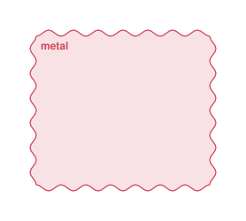
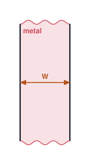
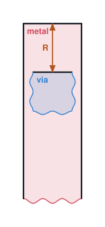
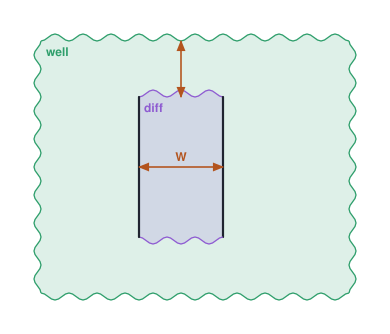
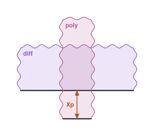
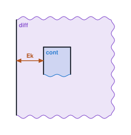
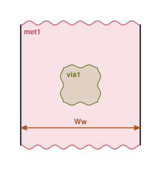
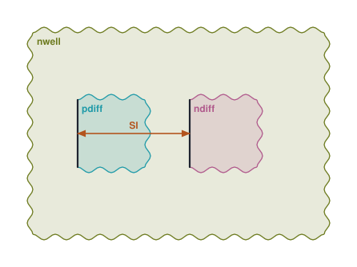

# From a design manual to a working deck

This is the short way in. It follows one complete example — an invented process with
eighteen rules of every kind, in [`examples/demo/`](../examples/demo) — from the
manual's page to a KLayout deck that has been run on a layout.
[`drawing-model.md`](drawing-model.md) is the reference for each convention used here.

## 1. A deck is a folder; a rule is a file

    fastdrc init mydeck

    mydeck/
      process.json            said once: layer numbers, legend, table columns, connections
      rules/
        1-wells/              a section of the manual is a folder
          NW.1.json           ONE rule, ONE file, ONE drawing
          NW.2.json
        2-devices/ ...
      build/                  generated: the KLayout script, and the rules as text

`process.json` holds what the manual's front matter holds (in the editor: the
"Process…" button):

    { "name": "Demo",
      "layers":  { "nwell": [1, 0], "diff": [2, 0], ... },                 GDS layer, datatype
      "legend":  { "pdiff": "diff and pimp", "gate": "poly and diff", ... },
      "columns": { "thin": [["not_interacting", "thick"]], "thick": [["overlapping", "thick"]] },
      "connect": [["ndiff", "nwell"], ["cont", "ndiff"], ["cont", "met1"], ...] }

The folder zipped is the same deck in one file, for passing around: `fastdrc pack
mydeck` writes `mydeck.zip` (without `build/`), `fastdrc unpack mydeck.zip` gives the
folder back, and `fastdrc init mydeck.zip` starts an empty one. Every command and the
editor take the zip where they take the folder — the editor saves straight into it —
and what is generated goes beside it, in `mydeck.build/`.

A deck may also be installed as a Python package and then given by its name: after `pip
install fastdrc-gf180mcu`, `fastdrc check chip.gds gf180mcu` (`fastdrc decks` lists what is
installed; what is generated goes into `gf180mcu.build/` in the current folder). Such a
package holds the deck folder and names it in the `fastdrc.decks` entry-point group:

    [project.entry-points."fastdrc.decks"]
    gf180mcu = "fastdrc_gf180mcu"          # a module; the deck is the folder it lies in

A rule file is a drawing and what the manual says about it:

    { "name": "NW.1", "desc": "N-well width",
      "shapes":   [ ... ],          what is drawn
      "measures": [ ... ],          the arrows
      "constraints": [ ... ] }      which shape is which layer, and what must hold

A manual's figure usually shows several rules at once. Here every rule gets its own
drawing, with only the shapes that rule is about: a drawing is read as a whole, so a
shape that belongs to another rule must not be in it. Draw it in the editor —
`fastdrc gui mydeck` lists the deck's sections and rules in one dropdown and shows one
rule at a time — or write the JSON; both are the same file. The example has three
sections: wells, devices, metal.

## 2. Draw what the figure shows

- A **shape** is an example of a layer: `NA.layer == nwell`. Its size on the page means
  nothing; only how shapes lie relative to each other does (inside, across, apart).
- An **edge** is drawn **straight** or **wavy**, and that is what turns a picture into
  a rule. A straight edge is one the rule uses: it is measured, or its length or
  corner matters. A wavy edge says "nothing is asked of this side — the shape goes
  on, or ends, as it likes". In the editor, double-click an edge to switch it.
- An **arrow** between two straight edges is a distance. The rule gives it a number.
  An arrow that ends on a wavy edge is a **link**: it measures nothing and says how
  the two shapes lie ("the diffusion *inside* the well").
- Names the manual uses for combinations go in the process's **legend** once
  (`pdiff = diff and pimp`) and are then drawn like any layer.
- A table with a value per column (thin / thick oxide, 3.3 V / 5 V) is the deck's
  `"columns"` plus `"values"` on the rule, with `?` where the number goes: one rule
  file, one rule per column in the deck.

The same rectangle, four meanings — only the kind of its edges differs:

|  |  |  |  |
|---|---|---|---|
| **no straight edge** — any shape of the layer: *metal must be at least 0.1 µm² in area* | **two straight sides** — a wire of any length: *metal must be at least 0.3 µm wide* | **the cap straight too** — the wire's end: *the end-of-line edge of a narrow metal wire must enclose via by at least 0.06 µm* | **an arrow to a wavy edge** — a link: *diff that lies inside well must be at least 0.4 µm wide* |

## 3. Say what the manual says

Every rule is one or two constraints. A **check** is what must hold; a **match** says
which shapes the rule is about.

| the manual says | you write | in the example |
|---|---|---|
| minimum width / space / enclosure | `check  W >= 0.8` on the arrow | NW.1, NW.2, CO.4 |
| a value per column | `check  Ep >= ?` and `"values": {"thin": 0.3, "thick": 0.6}` | NW.4 |
| the same rules for several layers ("intermediate metal: metal2, metal3") | `"each": {"metalint": ["metal2", "metal3"]}` in `process.json`, shapes drawn on `metalint` | (see the reference) |
| extension beyond, end cap | an arrow from the crossed layer's edge to the end; `check  Xp >= 0.2` | PO.2, PO.3 |
| exact size | `check  ka_0.length == 0.2` on a side | CO.1 |
| only square ones / bars | `match  ka_0.length == ka_1.length` (or `>`) | the contacts |
| any part within x of | `check  Sl <= 20`, the arrow drawn through the shape to its far side (between the facing edges: "has one within x") | LU.1 |
| on one of two adjacent sides; in one direction | `check  Ea >= 0.1 or Eb >= 0.1` over two arrows | V1.1, CO.3 |
| in an N × N or larger array | `match  K.rows >= 4 and K.columns >= 4` | CO.3 |
| wider than w | a width arrow with `match  Ww >= 2` | V1.2 |
| must hold at least n | `check  Count(V) >= 2` | V1.2 |
| on different nets / the same net | `match  A.net != B.net` | NW.3 |
| density, over the chip or per window | `check  M.density >= 0.2`, the material drawn inside the area or window | DN.1, DN.2 |
| area per connected gate area | `check  M.area <= 400 * G.area` | AN.1 |
| share of a plate's area | `check  S.area >= 0.06 * P.area`, S drawn inside P | (see the reference) |
| "Min/Max", "exactly" on a distance | `check  E == 0.1` on the arrow | (see the reference) |
| must be surrounded by a guard ring | the ring drawn as a donut, the device in its hole: `check  D in G.holes` | (see the reference) |
| must be rectangular | `check  F.corners == 4` | (see the reference) |
| total area on one plate | `check  Area(F) <= 10000`, F drawn in the plate | (see the reference) |
| a pitch, centre to centre; a centre in from an edge | an arrow that ends on a shape's centre (`"from": "A.centre"`): `check  P >= 80` | (see the reference) |
| total width of all fingers in one device | `check  Sum(k_0.length) >= 160`, the fingers drawn in the device | (see the reference) |
| every shape on the manufacturing grid | `"grid": 0.005` in `process.json` | (see the reference) |
| abutting shapes are fine everywhere | `"touching": "allowed"` in `process.json` | (see the reference) |
| an option of the process — metal stack, thick top metal ("for the 3 µm top metal: …") | `"parameters"` in `process.json`; in the rule a switch on one: `"value": {"switch": "top_metal", "cases": {...}}`, or `"when"` | built with `--profile` / `--set top_metal=30K` |
| must not exist / must not straddle | a cross on the shape or on the arrow | (see the reference) |

Four of the example's rules, each as it is drawn, what is written on it, and the
sentence the compiler reads back:

|  |  |  |  |
|---|---|---|---|
| **PO.2** `check Xp >= 0.2` | **CO.4** `match ka_0.length == ka_1.length`, `check Ek >= 0.1` | **V1.2** `match Ww >= 2`, `check Count(VW) >= 2` | **LU.1** `check Sl <= 20` |
| *poly must extend at least 0.2 µm beyond diff* | *diff must enclose square cont by at least 0.1 µm* | *every met1 at least 2 µm wide must hold at least 2 via1* | *every part of pdiff combined with nwell must be within 20 µm of ndiff combined with nwell — one in the same piece of nwell* |

The figures are made from the rule files by the `svg` backend
(`fastdrc build examples/demo --with svg` writes one per rule).

**Nets.** Rules about nets need to know how layers connect: which layers are one net
where they touch. That is said once for the deck, in `process.json`:
`"connect": [["ndiff", "nwell"], ["cont", "ndiff"], ["cont", "met1"]]`.

## 4. Read it back

    fastdrc build examples/demo

writes `build/demo.md` — every rule as a sentence, derived from the drawing — beside
the deck (`fastdrc rules examples/demo --to docs` prints the same):

    NW.3 — N-well space, wells on different nets
      • any two shapes of nwell must be at least 2 µm apart where the two are on different nets (euclidian).
    V1.2 — Vias on metal-1 wider than 2
      • every met1 at least 2 µm wide must hold at least 2 via1.
    LU.1 — P+ diffusion to the nearest well tap
      • every part of pdiff combined with nwell must be within 20 µm of ndiff combined with nwell — one in the same piece of nwell.
        where pdiff = diff and pimp
        where ndiff = diff and not pimp

If a sentence is not what the manual says, the drawing says something else — fix the
drawing, not the deck. Warnings on this step are worth reading: a rule that checks
nothing, a layer with no number, columns that leave a gap, a net rule with no stack.

## 5. Build and run

    fastdrc build examples/demo                  ->  build/demo.drc, build/demo.md
    fastdrc check layout.gds examples/demo       builds, runs KLayout, lists the violations

**Part of the deck.** `build`, `check` and `selftest` take the rules to build:

    fastdrc check layout.gds examples/demo --only 3-metal          one section
    fastdrc check layout.gds examples/demo --only "NW.*,CO.1"      rules by name (* and ? as in file names)
    fastdrc build examples/demo --skip "DN.*,AN.1"                 everything but these

The script is made for that set: only its rules, only the layers they need. The set is
compiled as one graph of layer operations, so what several rules need —
`cont.squares`, `pdiff.and(nwell)` — is computed once and released after its last use,
instead of once per rule. What can be shared depends on the set, so it is worked out at
every build; `--no-optimise` writes each rule out in full.

**On the layout's hierarchy.** `--deep` makes the deck work cell by cell (KLayout's
deep mode): a cell placed many times is checked once, which on a layout built from
repeated cells is several times faster. The same places are found; the numbers differ,
because a violation is reported once, in the cell it lies in, not once per placement.

    fastdrc check layout.gds examples/demo --deep

`check` needs KLayout (`klayout` on the PATH, or `KLAYOUT_BIN`). Without it, run the
deck yourself — it is plain KLayout DRC: the layers, the legend, and one statement per
rule with its name and description.

    klayout -b -r build/demo.drc -rd input=layout.gds -rd report=out.lyrdb

## 6. Check the deck on a layout

A deck is only known to be right once it has been run.

**As drawn.** The quickest check needs nothing from you:

    fastdrc selftest examples/demo

    18 rule(s) behave as drawn, 0 do not, 0 have no generated test yet
    (18 checks and 5 filters tested one by one).

Every constraint is tested on its own, on layouts made from the rule's picture: a
`check` with its quantity just outside the value (must be reported) and exactly at it
(must not); a `match` with a violation just outside the filter (must *not* be
reported — the filter filters) and just inside it. `-v` lists them. A rule that does
not behave as drawn means the picture and its meaning disagree; fix the drawing.
A rule that reports somewhere outside every test case is named too: it fires where
nothing was drawn for it.
A few kinds are not generated yet (antenna over several layers or with a diode, run
lengths, corners, shapes with a hole); `-v` names them, and they need cases of your
own, as below.

In the editor the same test is the **Test** button, for the rule being drawn.

**Planted errors.** `examples/demo/layout.rb` builds a layout for the example with
one error per rule and a clean counterpart next to it:

    klayout -b -r examples/demo/layout.rb -rd out=demo.gds
    fastdrc check demo.gds examples/demo

      NW.1            1  N-well width
      NW.3            2  N-well space, wells on different nets
      ...
    37 violation(s) of 17 rule(s); 1 of 18 rules clean. Report: demo.lyrdb

Every rule reports its planted error and nothing else (the one clean rule is the
chip-wide density, which the layout satisfies). For your
own process, cases just under, at, and just over each value — plus the exemptions the
manual's wording names — are the minimum.

**Real cells.** Small cases show a rule fires at its limit; real cells show what it
does everywhere else. Put a cell library side by side and run the deck on it clean; it
must be silent. Then put random small errors into it and, if the process has a
reference deck, compare the two reports by place:

    klayout -b -r tools/cells_in_a_row.rb -rd in=cells.gds -rd out=all.gds
    klayout -b -r tools/perturb_layout.rb -rd in=all.gds -rd out=edited.gds -rd seed=1
    tools/compare_reports.py ours.lyrdb reference.lyrdb

What this has caught so far, each time on real cells and never on the small cases: a
rule drawn on "diffusion or tap" that the manual states for diffusion only; an
exemption written into a rule's text; contacts that the manual splits into squares and
bars; two columns that between them dropped whatever lay across the column's boundary;
and a layer missing from the layer map.

## When the drawing cannot say it

If a rule in your manual has no row in the table above, look in the reference's recipe
list; if it is not there either, that is a gap in the model worth reporting, with the
manual's sentence and figure.
