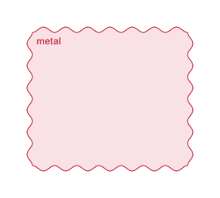
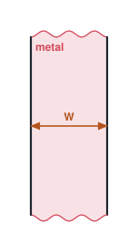
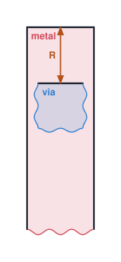
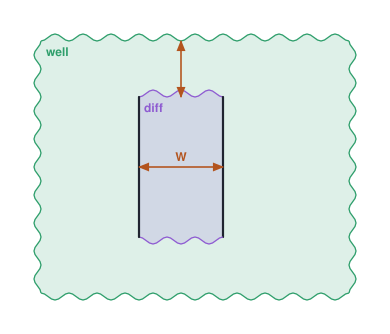

# What is FastDRC's own, and what was already known

FastDRC was designed with one outside model, the design manual: state a rule the
way the manual's page does, with a drawing, an arrow and a value. This page says
which part of FastDRC is its own, which part is manual practice, and which part
others had published earlier. The earlier work was looked up in November 2026,
before the first release.

Each thing FastDRC does is one of three kinds:

1. **Its own convention** — a rule defined by declaring every edge straight or
   wavy.
2. **Manual practice** — the way design manuals have always drawn rules.
3. **Published earlier by others** — in papers, and in patents that have since
   expired.

| What FastDRC does | Kind |
|---|---|
| A rule is a small drawing: example shapes on layers. Each edge is **straight** (the rule uses it) or **wavy** (nothing is asked of that side). | the drawing is manual practice; defining the rule by straight and wavy edges is its own |
| Arrows between edges carry a name; constraints are text on those names (`W >= 0.8`). A constraint is a check, or a filter that selects where the rule applies. | manual practice; published earlier |
| A compiler reads the relations between the drawn shapes (inside, contains, overlap, touch, apart) and writes a deck for an existing DRC tool. | published earlier |
| A deck is one graph of layer operations; what several rules need is computed once. | published earlier |
| The same description gives the rule as a sentence and as a figure. | manual practice |
| Self-test: small layouts built from each drawing, just outside the limit and exactly at it, run through the deck. | published earlier |
| Output goes through backends, which are plugins. | published earlier |

## FastDRC's own: rules defined by straight and wavy edges

Every edge of a drawn shape is one of two kinds. A straight edge is one the rule
uses: it is measured, or its length or its corner matters. A wavy edge asks
nothing: the shape may go on, or end, in any way. One rectangle therefore means
four different things:

|  |  |  |  |
|---|---|---|---|
| no straight edge: any shape of the layer | two opposite sides straight: a wire of any length | the end straight as well: the end of a wire | an arrow ending on a wavy edge: a relation ("the diff inside the well"), not a distance |

The marking is what turns a picture into a rule and not a fixed pattern: it says
which parts of the picture are the rule and which are only there to show the
situation.

It has been part of FastDRC from the first commit of this repository (2026-06-09):
the rule editor, `python/fastdrc/editor.py`, opened with "A rule is ONE primitive
family: polygons whose every side is STRAIGHT or WAVY" and "WAVY side = 'material
continues past here'".

### In the public design manuals

| Manual | Wavy or broken edges in its figures |
|---|---|
| SkyWater SKY130, periphery rules | none |
| GF180MCU design manual | none on shapes; one break through an array |
| IHP SG13G2 layout rules, rev. 0.4 | one jagged wire end |
| FreePDK45 rule pages | none |

All four draw shapes as plain polygons with straight sides, put double-headed
arrows labelled with the rule name where a distance matters, and give a legend of
layers. SKY130 and GF180MCU draw a cross over an arrangement that is forbidden.
IHP has one page (figure 4.1, "Rule check schematics") with a generic picture for
each kind of rule: width, space, enclosure, overlap, extension, area.

Two figures use the drafting break line, to say that something goes on:

- GF180MCU, contact figure, rule CO.2b: an array of contacts cut by a zigzag break
  with the note "m & n ≥ 4". Rows and columns are left out; the array continues.
- IHP SG13G2, figure 6.13 (MIM capacitor): a metal wire drawn with a jagged end,
  facing another jagged end, labelled "Metal5 to Metal1 connection". The wire goes
  on; the part in between is left out.

The second is drawn on the edge of a shape and means what a wavy edge means in
FastDRC: the material continues. So "a broken edge = the shape goes on" is ordinary
drafting practice and can be found in a design manual, as an occasional
abbreviation of a picture. No rule depends on it there, and every other edge in
those figures is plain.

### Nearest ideas

| What | Where | How it differs |
|---|---|---|
| Break lines: a wavy or zigzag line means the object continues beyond the view | Engineering drawing (ASME Y14.2, ISO 128); once each in the GF180MCU and IHP manuals | An occasional abbreviation of a picture; it does not declare, edge by edge, what the rule uses |
| "Don't care" regions in a layout pattern | Yao et al., ICCAD 2006: "regions in the range pattern that do not require user specification and allow any combination of rectangles to exist" | An area, not an edge; used to find a pattern in a layout, not to state a rule |

### What exactly is FastDRC's own

What a single wavy edge means is drafting practice. What is FastDRC's own is the
use made of it: every edge of every drawn shape is declared straight or wavy, and
that declaration is the rule's definition. It decides whether a rectangle means any
shape, a wire, or the end of a wire, and whether an arrow is a distance or a
relation. In the manuals above and in the published work below, no figure, format
or tool states a rule this way.

## Known from design manuals: the manual page

A design manual states a rule as a figure with dimension arrows, a table of values
and a sentence. This was FastDRC's model from the start: its drawing, constraint
and generated sentence are that page.

| Year | Source | What it shows |
|---|---|---|
| 1981 | R. F. Lyon, "Simplified Design Rules for VLSI Layouts" | shapes on layers with dimension marks ("2 Gate Extension", "POL to CUT"); "clearance is required as illustrated in figure 4" |
| 2020 | SkyWater SKY130 periphery rules | shapes, arrows labelled with rule names, a cross over what is forbidden |
| 2022 | GF180MCU design manual | shapes, arrows labelled with rule names, layer legend, crosses |
| 2024 | IHP SG13G2 layout rules, rev. 0.4 | a generic picture per kind of rule (figure 4.1), then a figure per layer with lettered arrows |

These parts of FastDRC are manual practice: a rule shown as example shapes; an
arrow with a name where a distance matters; a value against the name; a cross for
"must not exist"; the rule as a sentence beside its figure.

## Known from earlier publications

Every patent listed here has run its full term.

### A rule entered as a drawing and turned into checks

| Date | Source | What it discloses |
|---|---|---|
| 1989 | W. Ries, "Rule-based implementation of correct and efficient VLSI design rule checking" | "automatic and optimized compilation of VLSI design rule checking directives from graphically specified design rules" |
| 1999 | US6611946B1, Avant! (Synopsys); expired 2019 | "a simple spacing rule is illustrated in the GUI form as two shapes with an arrow between them"; the value on the arrow "is extracted and used to create a rule in the native language" |

Entering a rule as drawn shapes with an arrow and a value, and compiling that into
checking code, has been public since 1989 and is described in a patent that expired
in 2019.

### One description, decks for several tools

| Date | Source | What it discloses |
|---|---|---|
| 1999 | US6611946B1 and US6606735B1; both expired 2019 | "defining a meta language that hides from the user the language of a specific verification tool"; "the meta runset is independent of verification and layout tools and languages"; one template library per tool |
| 2016–17 | E. Ravve, "Template Based Automatic Generation of Runsets" | manual, runsets and test cases from one set of templates |
| 2018 | Si2 OPAL | "a new, formal declarative language"; "English descriptions and illustrations can no longer do the job." |
| 2024 | Krinke, Fischbach, Lienig, ISPD 2024 | KLayout DRC scripts generated "from a more abstract representation" |

### The deck as a graph; shared operations computed once

| Date | Source | What it discloses |
|---|---|---|
| 1999 | US6611946B1; expired 2019 | each derived layer defined just before first use, and not again "If layer was previously defined" |
| 2005 | US7409656B1, Cadence; expired 2026 | "Vertices in the dependency graph denote operations to be executed."; "Edges in the graph denote layers that create dependencies between the operations."; rules executed in parallel |

### Test layouts per rule, pass and fail

Two IBM patents, both expired, describe between them every part of the self-test.

| Part of the self-test | US6732338B2, IBM (filed 2002; expired 2022) | US6063132A, IBM (filed 1998; expired 2018) |
|---|---|---|
| test cases are generated | "automatically creating testcases for design rule checking"; the rule table from the manual "is used to create approximately 90% of the testcases" | — |
| a set of cases for each rule | "testcases comprising shapes representing pass and fail conditions for each ground rule extracted from said design rule manual" | "Each row contains all test structures for a each groundrule" |
| cases that must pass and cases that must fail | "make sure each ground rule check is exercised with a passing and a failing testcase" | "testcases designed to fail the design rules check and testcases designed to pass" |
| the cases arranged into one layout | "organizing said testcases into a library" of root cells; "laid out such that fails are expected on the left hand side of the y-axis, and passes on the right hand side" | "organized in rows of test structures 60 on an x-y plane"; "x>0 are intended to pass (produce no error shape), and those located x<0 are intended to fail" |
| the deck run on it, result compared with what was expected | "running a design rule checking runset against said testcases"; a log table per rule of intentional and unintentional fails and passes | five categories: intentional fail, intentional pass, unintentional fail, unintentional pass, missing boundary; a summary file |
| a wrong result is fixed in the deck or in the test case | — | "the runset file 12 and/or testcase file 14 is modified" |

Also US6606735B1 (1999; expired 2019): a test cell with a pass pattern and a fail
pattern per rule, expected results saved and compared.

The self-test builds its cases from FastDRC's own drawings and otherwise follows
this long-published practice.

## Sources

**Design manuals**

- SkyWater SKY130 PDK, periphery rules — https://skywater-pdk.readthedocs.io/en/main/rules/periphery.html
- GlobalFoundries GF180MCU PDK, design manual — https://gf180mcu-pdk.readthedocs.io
- IHP SG13G2 Open Source PDK, Layout Rules rev. 0.4 — https://github.com/IHP-GmbH/IHP-Open-PDK
- FreePDK45 design rules, NCSU EDA wiki (pages FreePDK45:PolyRules, WellRules, ImplantRules, MetalIntRules), as archived at web.archive.org

**Papers and articles**

- R. F. Lyon, "Simplified Design Rules for VLSI Layouts", Southcon 1981 — https://dicklyon.com/tech/Scans/DesignRules-Lyon.pdf
- W. Ries, "Rule-based implementation of correct and efficient VLSI design rule checking", IEEE MIV-89, 1989 — DOI 10.1109/MIV.1989.40550
- H. Yao, S. Sinha, C. Chiang, X. Hong, Y. Cai, "Efficient Process-Hotspot Detection Using Range Pattern Matching", ICCAD 2006
- E. Ravve, "Template Based Automatic Generation of Runsets", ICCGI 2016; Int. J. on Advances in Software 10(1-2), 2017
- Si2, Open Pattern Analysis for Layout (OPAL), announcement of 1 June 2018
- A. Krinke, R. Fischbach, J. Lienig, "Layout Verification Using Open-Source Software", ISPD 2024

**Patents**

| Patent | Owner | Filed | Expired |
|---|---|---|---|
| US6063132A | IBM | 26 June 1998 | 26 June 2018 |
| US6611946B1 | Avant! (Synopsys) | 14 October 1999 | 14 October 2019 |
| US6606735B1 | Avant! (Synopsys) | 14 October 1999 | 14 October 2019 |
| US6732338B2 | IBM | 20 March 2002 | 5 June 2022 |
| US7409656B1 | Cadence | 12 September 2005 | 30 May 2026 |
